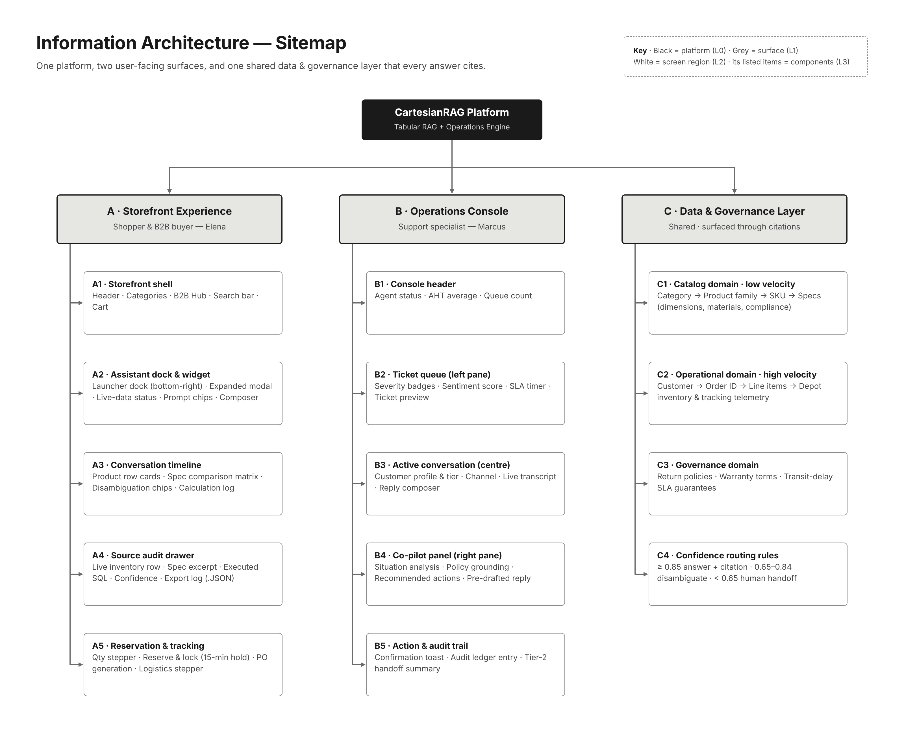
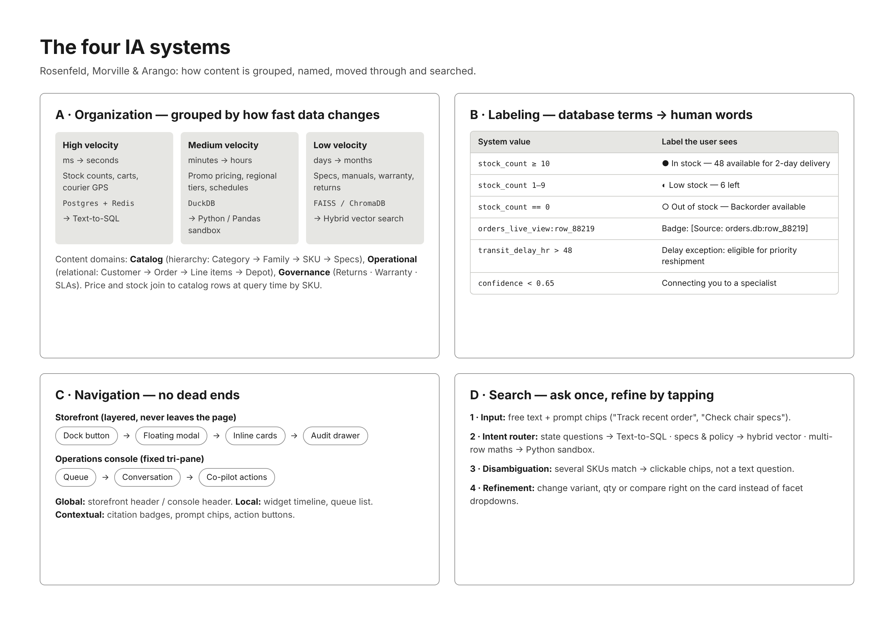
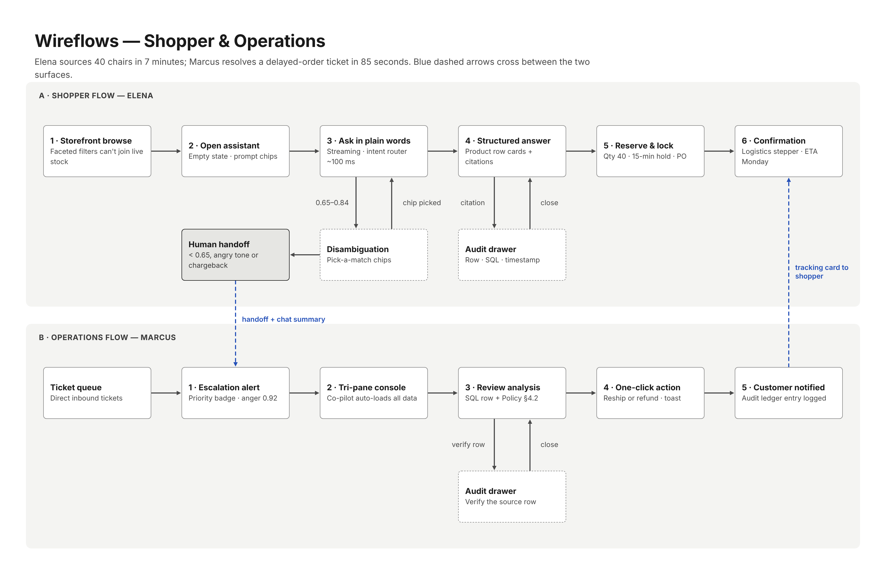
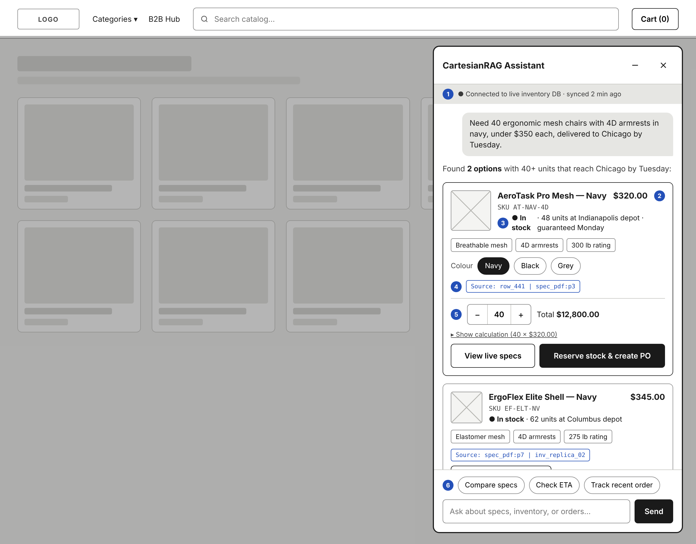
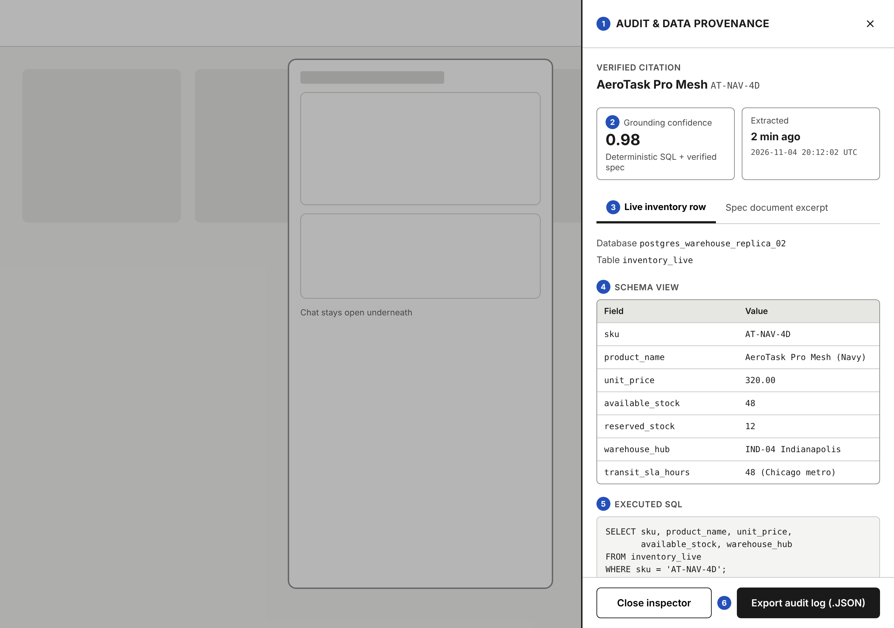
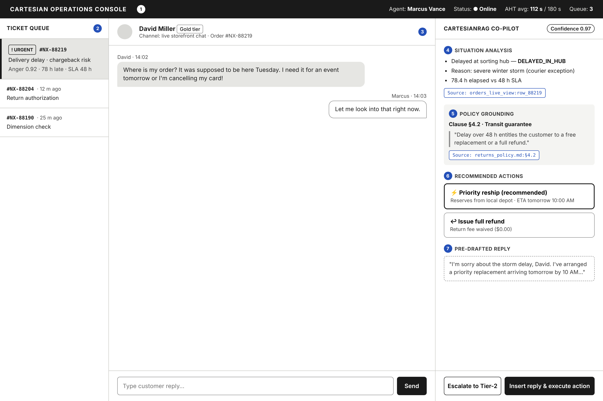
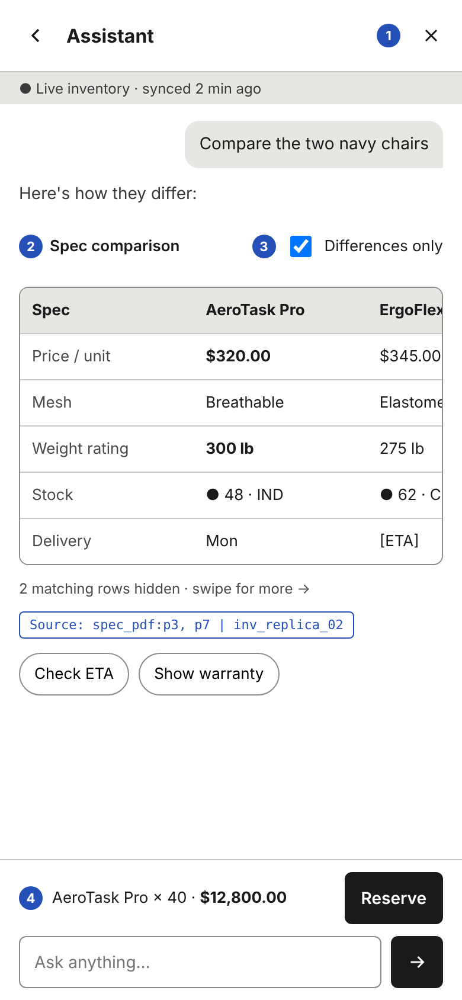
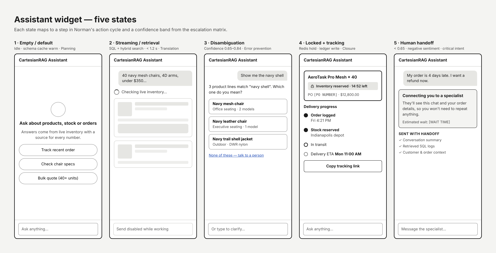

# CartesianRAG: Enterprise Tabular RAG and Operations Engine for Omnichannel E-Commerce

*Case study v3 · Author: Dex · v3 replaces the ASCII wireframe blueprints with the low-fidelity wireframes from the design canvas, and links the clickable prototype.*

| Artifact | Where |
| :--- | :--- |
| Low-fidelity wireframes (images) | [`images/`](../images/) |
| Clickable usability-test prototype | [`prototype/index.html`](../prototype/index.html) |

## Executive Summary and System Architecture

Modern e-commerce enterprises rely on massive, high-velocity tabular datasets including real-time warehouse inventory, multi-tier pricing contracts, fluctuating shipping tariffs, and live order states. Traditional Large Language Model agents and naive Retrieval-Augmented Generation pipelines fail in these environments: flattening relational tables into unformatted text chunks strips column relationships, exceeds context window budgets, and produces hallucinations around pricing, discount logic, and stock availability.

CartesianRAG is an enterprise-grade design framework and system architecture that bridges natural language customer interactions with deterministic database precision. By coupling a deterministic Text-to-SQL Engine for transactional tables with Row-Level Hybrid Vector Indexing for catalog attributes and a Sandboxed Python Code Execution Agent for multi-step analytics, CartesianRAG eliminates numeric hallucinations while providing a verifiable, direct-manipulation interface for both shoppers and enterprise support specialists.

### End-to-End Query and Data Flow

1. **User Natural Language Query**: The user asks an exploratory, tracking, or analytical question through the conversational commerce widget or operations console.
2. **Intent Router and Schema Disambiguator**: Determines the optimal retrieval path based on query complexity:
   - *Transactional and State Queries*: Directed to the Text-to-SQL Engine.
   - *Catalog Specifications and Policy Queries*: Directed to Row-Level Hybrid Vector Retrieval.
   - *Complex Multi-Row Analytical Queries*: Directed to the Sandboxed Python Runtime.
3. **Dual Execution and Retrieval Bus**:
   - *Text-to-SQL*: Generates syntax-checked SQL against read-replicas of PostgreSQL or DuckDB transactional databases.
   - *Row-Level Hybrid Search*: Combines dense semantic vector embeddings (`all-mpnet-base-v2`) with sparse lexical matching (BM25) via Reciprocal Rank Fusion.
   - *Cross-Encoder Reranker*: Evaluates query-candidate pairs using `ms-marco-MiniLM-L-12-v2` to select the top candidate rows.
4. **Context Synthesis and Guardrails**: Formulates deterministic context blocks with verifiable row citations.
5. **Direct Manipulation UI Delivery**: Outputs structured, interactive UI micro-components (inline product row cards, side-by-side spec comparison tables, live order logistics steppers) directly into the timeline.

---

## Research and Understand

To design an interface and retrieval pipeline capable of handling dynamic tabular data, we conducted a comprehensive discovery study rooted in the Nielsen Norman Group UX Research Framework, combining contextual inquiries, attitudinal surveys, and behavioral usability benchmarking across consumer and enterprise touchpoints.

### 1. Understand the Users: The Dual Ecosystem

An enterprise e-commerce platform functions as an interdependent, two-sided ecosystem. Any breakdown in data accuracy or interface communication on the consumer side propagates directly into operational gridlock on the support side.

#### User Group A: The External High-Intent Shopper and B2B Buyer
External buyers operate under significant time constraints, browsing frequently via mobile or split-screen desktop windows. They often manage multi-attribute purchasing constraints (strict budget ceilings, exact dimensional requirements, or urgent delivery deadlines). Their cognitive mode is goal-directed search and post-purchase reassurance. Users require immediate clarity without navigating deep nested filter dropdowns or deciphering ambiguous status messages.

#### User Group B: The Customer Operations Specialist and Support Lead
Internal support specialists work in high-stress, multi-monitor desktop environments managing active ticket queues under strict First Contact Resolution (FCR) and Average Handle Time (AHT) SLAs. Their cognitive mode is systematic cross-verification. Representatives constantly cross-reference disparate backends (Warehouse Management Systems, ERP inventory tables, billing ledgers, and courier tracking feeds) while de-escalating customer friction.

#### User Personas

##### Persona 1: Elena Rostova (B2B Corporate Procurement and High-Intent Consumer)
* **Demographics**: Age 34, Senior Facilities Buyer, mobile and laptop user.
* **Core Quote**: "I do not have time to cross-reference thirty product specification PDFs against an inventory matrix. Tell me if you have forty units of ergonomic mesh chairs with 4D armrests in navy, under \$350 each, and guarantee delivery to our Chicago hub by Tuesday."
* **Behavioral Attributes**: Queries using complex multi-attribute constraints (dimensions, volume tiers, testing certifications). Abandons platforms immediately if an item marked in stock fails at checkout. Requires verifiable SKU specifications for corporate compliance audits.
* **Critical Pain Points**: Standard keyword search engines match irrelevant tags (such as navy matching blue USB cables). Chatbots provide verbose text paragraphs but cannot execute batch price calculations.
* **Design Implications**: Structured conversational responses must output compact, interactive product comparison cards with inline attribute selectors and deterministic stock counters.

##### Persona 2: Marcus Vance (Tier-1 Customer Operations and Logistics Specialist)
* **Demographics**: Age 28, Customer Operations Center, triple-monitor desktop workstation.
* **Core Quote**: "I spend half my shift switching between our PostgreSQL order database, FedEx tracking feeds, and support tickets. If an automated tool suggests an action to me, I need to see the exact database row it came from before I authorize a \$200 replacement."
* **Behavioral Attributes**: Evaluates system outputs under strict time pressure (target AHT under 180 seconds). Manually calculates return eligibility, restocking fees, and transit delay compensation. Deeply skeptical of automated suggestions lacking data lineage and provenance.
* **Critical Pain Points**: Swivel-chair syndrome caused by repeatedly copying SKUs and tracking IDs across four disconnected tabs. Chatbots that hallucinate store credit policies, leaving representatives to manage customer fallout.
* **Design Implications**: Unified Operations Co-Pilot sidebar with real-time confidence scores, raw database row citations, and single-click action buttons (such as issuing return labels or rerouting shipments).

---

### 2. Key Pain Points and Friction Areas

Synthesizing findings from twelve contextual inquiries, 250 customer surveys, and 45 logged support sessions revealed four critical friction clusters:

| Friction Domain                                  | Root Cause (Technical and UX)                                                                                                                                                                   | Behavioral Impact and User Metric                                                                                                                           |
| :----------------------------------------------- | :---------------------------------------------------------------------------------------------------------------------------------------------------------------------------------------------- | :---------------------------------------------------------------------------------------------------------------------------------------------------------- |
| **Confident Hallucination in Pricing and Stock** | Traditional text RAG retrieves unstructured catalog snippets without querying live relational SQL tables.                                                                                       | **68%** of surveyed shoppers experienced cart abandonment or post-checkout cancellation due to incorrect inventory signals.                                 |
| **Filter Fatigue and Vocabulary Mismatch**       | Faceted navigation requires manual multi-select clicks; keyword search fails on semantic intent (for example, searching water-resistant trail shell yields zero hits when tagged as DWR nylon). | **42%** increase in search abandonment when shoppers are confronted with more than four nested filter layers.                                               |
| **Swivel-Chair Latency in Support Operations**   | Operations agents must manually query PostgreSQL order tables, ERP backends, and WMS logistics feeds across disconnected browser windows.                                                       | Support specialists spend an average of **74 seconds per ticket** copying and pasting identifiers across tabs; average handle time reaches **6.2 minutes**. |
| **The Black Box Trust Barrier**                  | Generic conversational bots answer with declarative text without source citations, preventing agents from verifying complex return rules or warranty dates.                                     | **81%** of support representatives distrust automated agent recommendations unless raw table rows or policy clauses are displayed inline.                   |

---

### 3. Data Freshness and System Constraints

Tabular data in e-commerce changes at radically different velocities. Managing these operational dynamics requires separating data into distinct operational tiers rather than treating all tables uniformly:

#### Stratified Velocity Tiers
1. **High-Velocity Tier (Milliseconds to Seconds)**:
   - *Data Assets*: Real-time stock counts, active user carts, courier GPS and transit telemetry.
   - *Storage Engine*: PostgreSQL read-replicas and in-memory Redis caches.
   - *Retrieval Pattern*: Deterministic Text-to-SQL queries and primary key lookups.
2. **Medium-Velocity Tier (Minutes to Hours)**:
   - *Data Assets*: Dynamic promotional pricing rules, regional tier adjustments, warehouse fulfillment schedules.
   - *Storage Engine*: DuckDB analytical instances and synchronized read caches.
   - *Retrieval Pattern*: Sandboxed Python code execution using Pandas for aggregation and filtering.
3. **Low-Velocity Tier (Days to Months)**:
   - *Data Assets*: Product catalog technical specifications, user manuals, warranty terms, return policies.
   - *Storage Engine*: Vector databases (FAISS, ChromaDB) storing serialized row documents.
   - *Retrieval Pattern*: Row-level dense semantic search combined with BM25 lexical search and cross-encoder reranking.

#### Technical Bottlenecks and Architectural Constraints
* **The Vector Re-Indexing Bottleneck**: Vector embeddings cannot be recomputed continuously every time an inventory counter decrements from four to three units. Pricing and stock counts are decoupled from static vector embeddings and joined dynamically at query time via SQL foreign keys using the unique SKU identifier.
* **Context Window Saturation**: Passing multi-thousand-row tables directly into LLM prompts consumes excessive tokens and degrades reasoning accuracy. CartesianRAG limits vector context injection to the top five reranked rows, delegating large-scale aggregations to the Python Pandas runtime.
* **End-to-End Latency Budget**: To maintain user engagement, total conversational response time must remain under **1,200 ms** (Intent Routing: ~100 ms, Hybrid Retrieval / SQL Execution: ~400 ms, LLM Streaming First-Token: ~600 ms).

---

### 4. Trust, Transparency, and Verifiability

Trust is the foundation of AI-assisted commerce. To satisfy the verification demands of end-shoppers and enterprise compliance auditors, CartesianRAG enforces a strict Data Provenance and Traceability Contract:

* **Verifiable Citation Badges**: Every factual statement involving price, delivery dates, or stock availability concludes with an interactive citation badge referencing the underlying table and row identifier.
* **Interactive Source Audit Drawer**: Clicking an inline citation badge slides open an inspector drawer showing the exact database record, schema headers, extraction timestamp, and model confidence score.
* **Deterministic Calculation Logs**: For questions involving discount tiers or multi-item totals, users and agents can toggle an audit dropdown that displays the verified mathematical formula and code execution trace.

#### Schema Audit Verification Example
When an automated response references an order status (for example: "Order #NX-88219 qualifies for a free replacement under our 30-day transit guarantee"), the audit drawer displays:
* **Table Source**: `orders_live_view` on PostgreSQL Replica-02.
* **Row Identifier**: 88219.
* **Key Fields**: `order_id` (NX-88219), `customer_id` (CUST-9021), `order_date` (2026-10-18), `current_status` (DELAYED_IN_HUB), `transit_delay_hr` (78.4 hours against a 48-hour SLA).
* **Validated SQL**: `SELECT * FROM orders_live_view WHERE order_id = 'NX-88219';`

---

### 5. UI/UX Paradigm Shift: Direct Manipulation over Text

Traditional conversational AI traps users in passive, chat-only text reading loops. Users must read through lengthy paragraphs of generated text, mentally parse comparisons, and manually type follow-up questions.

Rooted in Ben Shneiderman’s Direct Manipulation Principles and Don Norman’s Action Cycle, CartesianRAG replaces text walls with purpose-built, interactive micro-components embedded directly into the conversational timeline:

#### Core Direct-Manipulation Components
1. **Interactive Product Row Cards**: Cards display dynamic price indicators, variant buttons (size, color, finish), and direct Add-to-Cart triggers. Modifying a variant updates inventory numbers in real time without refreshing the chat session.
2. **Compact Spec Comparison Matrix**: Structured comparison tables featuring side-by-side specification alignment, sticky table headers, and difference toggles to highlight divergent attributes across models.
3. **Live Order Logistics Stepper**: An interactive shipping status tracker displaying milestone breadcrumbs (Order Placed, Cleared Sorting Hub, In Transit, Out for Delivery) with live courier countdown estimates.

---

### 6. Guiding the Next Step in the Design Process

To transition from architectural discovery to production UI engineering, we established clear system governance rules, escalation thresholds, and a standardized design token system.

#### Confidence Scoring and Escalation Threshold Matrix

| Confidence Score | System State | Trigger Condition | UX Action and Fallback Behavior |
| :--- | :--- | :--- | :--- |
| **0.85 to 1.00** | **Autonomous Resolution** | Exact SQL match or top reranked row similarity score greater than or equal to 0.85. | Deliver interactive component with verified table citation badge. |
| **0.65 to 0.84** | **Guided Disambiguation** | Multiple table rows match query criteria (for example, query specifies navy shell but three distinct product lines match). | Display structured selection chips allowing the user to select the intended product model. |
| **Below 0.65 or Sentiment Alert** | **Human-in-the-Loop Escalation** | Semantic failure, negative sentiment detection, or critical intent (such as chargeback disputes or lost shipments). | Seamless handoff to Tier-2 support agent. Injects full conversation summary, retrieved SQL logs, and customer context into the operations console. |

#### Design Tokens and UI Architecture (Tailwind CSS and Shadcn/UI)

To support accessible, high-performance web deployment, CartesianRAG adopts a tokenized design system built on Shadcn/UI standards and Tailwind CSS. All components comply with WCAG 2.1 Level AA standards, ensuring a minimum 4.5:1 text contrast ratio and complete keyboard navigation affordances.

```json
{
  "color": {
    "brand": {
      "primary": "#0F172A",
      "primary-foreground": "#F8FAFC",
      "accent": "#2563EB",
      "accent-hover": "#1D4ED8"
    },
    "surface": {
      "card": "#FFFFFF",
      "card-border": "#E2E8F0",
      "audit-drawer": "#F1F5F9"
    },
    "status": {
      "in-stock": "#16A34A",
      "low-stock": "#D97706",
      "out-of-stock": "#DC2626"
    }
  },
  "typography": {
    "font-sans": "Inter, -apple-system, BlinkMacSystemFont, sans-serif",
    "font-mono": "JetBrains Mono, monospace"
  },
  "spacing": {
    "card-padding": "1rem",
    "drawer-width": "28rem"
  }
}
```

---

## UX Storyboards and User Journeys

To connect the discovery research with visual interface engineering, we map the dual ecosystem into two multi-layered storyboard sequences. Each scene details physical setting, human emotional shifts, visible UI affordances (frontstage), and underlying Tabular RAG engine actions (backstage).

### Storyboard 1: The B2B Procurement Journey — "The Friday Deadline Crunch"
* **Persona**: Elena Rostova (Senior Facilities Buyer)
* **High-Stakes Goal**: Source 40 ergonomic mesh chairs with 4D armrests in navy, under \$350 each, delivered to the Chicago hub by Tuesday morning for an office opening.
* **Core Problem**: Traditional e-commerce faceted search requires navigating 14+ dropdowns, while generic chatbots provide ungrounded text paragraphs that hallucinate prices and miss out-of-stock items.

```
       SCENE 1                    SCENE 2                    SCENE 3
 [ The Filter Trap ] ----> [ Natural Query & ] ----> [ Direct Manipulation ]
   (Friday, 4:15 PM)         (Intent Routing)          (Live Tabular Cards)
                                                                 |
                                                                 v
       SCENE 6                    SCENE 5                    SCENE 4
[ Seamless Checkout ] <--- [ 1-Click Inventory ] <--- [ Verifiable Source ]
 (Order Lock & Hold)         (Reservation PO)           (Audit Drawer)
```

#### Frame 1: The Frustration of Faceted Search
* **Physical Setting & Posture**: Office desk, Friday 4:15 PM. Elena has three browser tabs open with 14 nested filter dropdowns on screen. Her hand is on her forehead in visible frustration.
* **Context & Motivation**: Elena has spent 15 minutes checking filter checkboxes (Color, Armrest type, Material, Wheel casters). The catalog shows 200 items, but opening the top listings reveals only 2 to 4 units available per warehouse.
* **User Action**: Closes out of third dead-end tab, realizing standard faceted search cannot join real-time inventory counts.
* **System Backstage**: Legacy catalog search indexes evaluate static metadata without executing real-time joins against live warehouse inventory tables.
* **Emotional State**: 🔴 **Frustrated (-2)** — High cognitive load, fear of missing the Tuesday delivery deadline.
* **HCI Principle**: *Gulf of Execution* — The interface forces unnatural physical clicks that fail to map to the user's high-level goal.

#### Frame 2: Natural Language Tabular Intent
* **Physical Setting & Posture**: Elena spots the CartesianRAG conversational shopping widget on the storefront and leans forward toward her keyboard.
* **Context & Motivation**: Decides to test whether natural language can handle her complex multi-attribute business constraints directly.
* **User Action**: Types into the widget: *"Need 40 ergonomic mesh chairs with 4D armrests in navy, under $350 each, delivered to Chicago by Tuesday."*
* **System Backstage**:
  1. *Intent Router*: Classifies input as a compound query requiring catalog specification matching alongside relational SQL filtering (`price <= 350`, `quantity >= 40`, `delivery_eta <= 96 hours`).
  2. *Entity Disambiguation*: spaCy NER parses `attribute` (4D armrests, mesh), `color` (navy), `quantity` (40), and `destination` (Chicago).
  3. *Dual Execution Bus*: Dispatches hybrid search against catalog vectors while querying PostgreSQL inventory read-replicas.
* **Emotional State**: 🟡 **Skeptical / Curious (0)** — Hoping for an answer, anticipating generic chatbot text.
* **HCI Principle**: *Planning & Translation* — Natural language affordances lower cognitive friction by accepting human mental models directly.

#### Frame 3: Direct Manipulation over Text Walls
* **Physical Setting & Posture**: Elena's eyes widen as structured, actionable product cards appear on screen in under 850 ms.
* **Context & Motivation**: Needs immediate confirmation of specifications and real-time inventory without reading dense text paragraphs.
* **User Action**: Reviews two interactive **Product Row Cards**. The top card displays the *AeroTask Pro Mesh* at \$320/unit with a green stock indicator: **"48 units available at Indianapolis Regional Depot (Guaranteed Monday Delivery)"**.
* **System Backstage**:
  1. Dense embeddings (`all-mpnet-base-v2`) and BM25 retrieve top 10 catalog candidates.
  2. Cross-Encoder (`ms-marco-MiniLM-L-12-v2`) reranks rows matching the 4D armrest constraint.
  3. SQL executes against live depot inventory: `SELECT stock, depot_city FROM inventory_live WHERE sku = 'AT-NAV-4D' AND stock >= 40;`
  4. Response formats directly into a Shadcn/Tailwind interactive card component rather than prose.
* **Emotional State**: 🟢 **Relieved (+1)** — Zero fluff; pricing, specs, and guaranteed stock counts are visible immediately.
* **HCI Principle**: *Direct Manipulation* — Visible objects of interest with instant visual feedback (Shneiderman).

#### Frame 4: Verifying the Source (Audit Drawer Inspection)
* **Physical Setting & Posture**: Elena hovers her cursor over the blue citation badge `[Source: row_441 | spec_pdf:p3]`.
* **Context & Motivation**: Elena must present verified compliance specs to her corporate purchasing director; she cannot risk chairs that fail ANSI/BIFMA standards or exceed desk height clearances.
* **User Action**: Clicks the citation badge. An inspector drawer slides open displaying exact database schema fields (seat height 18.5"–22.0", 300 lb rating) and the last sync timestamp (2 minutes ago).
* **System Backstage**: The client fetches the cached provenance payload from the server without triggering an expensive LLM re-run.
* **Emotional State**: 🟢 **Confident (+2)** — Full transparency eliminates fear of hallucinated specifications.
* **HCI Principle**: *Bridging the Gulf of Evaluation* — Traceable data provenance provides verifiable feedback.

#### Frame 5: One-Click Stock Reservation
* **Physical Setting & Posture**: Elena selects quantity "40" using the inline stepper and clicks **"Confirm Purchase Order & Lock Inventory"**.
* **Context & Motivation**: Ready to commit, she needs certainty that warehouse stock is reserved while corporate accounting processes the PO.
* **User Action**: Clicks the confirmation button. The card updates with a green lock badge: *"Inventory Reserved for 15 Minutes"*.
* **System Backstage**: A Redis distributed lock decrements available stock from 48 to 8 for other buyers and writes the reservation transaction to the PostgreSQL ledger.
* **Emotional State**: 🟢 **Empowered (+2)** — Frictionless transition from search to purchase.
* **HCI Principle**: *Action & Outcome Execution* — Norman's Action Cycle completed with deterministic system response.

#### Frame 6: Reassurance and Order Stepper Tracking
* **Physical Setting & Posture**: Elena sits back and closes her laptop at 4:22 PM. Total time elapsed: 7 minutes.
* **Context & Motivation**: Elena requires an immediate audit trail and tracking link to share with her logistics coordinator.
* **User Action**: Observes the interactive **Logistics Stepper** displaying milestone breadcrumbs (Order Logged → Stock Reserved → In Transit → Delivery ETA Monday 11:00 AM).
* **System Backstage**: Generates an audit record in the transactional database and fires webhook notifications to the regional fulfillment warehouse.
* **Emotional State**: 🟢 **Delighted and Loyal (+2)** — Procurement time reduced from 45 minutes to 7 minutes.
* **HCI Principle**: *Closure & Assessment* — Explicit confirmation dialog yields psychological closure.

---

### Storyboard 2: The Operations Co-Pilot Journey — "Zero-Swivel Resolution"
* **Persona**: Marcus Vance (Tier-1 Customer Support Specialist)
* **High-Stakes Goal**: Resolve an angry customer inquiry regarding an urgent order delay under a strict 3-minute SLA.
* **Core Problem**: Support specialists spend 74 seconds per ticket copying IDs across 4 disconnected tabs (PostgreSQL, courier tracking, warehouse WMS, return policy PDF), driving AHT over 6 minutes.

#### Frame 1: The Escalation Alert
* **Physical Setting & Posture**: Support operations room, dual-monitor desktop. Marcus receives a high-priority chat notification flashing with an urgent alert tag: *"Customer requesting refund: Order #NX-88219 delayed in transit for 4 days."*
* **Context & Motivation**: Marcus has an Average Handle Time (AHT) target under 180 seconds. The customer is threatening a credit card chargeback.
* **User Action**: Clicks the incoming ticket to accept the session.
* **System Backstage**: The CartesianRAG Operations Co-Pilot intercepts the conversation, extracts the order ID, and runs sentiment analysis (Anger: 0.92, Escalation Risk: High).
* **Emotional State**: 🔴 **High Stress (-1)** — Urgency to de-escalate without violating company refund policies.

#### Frame 2: Zero-Swivel Synthesis on the Co-Pilot Sidebar
* **Physical Setting & Posture**: Marcus looks at his right-hand screen where the CartesianRAG Co-Pilot panel has automatically loaded all relevant data.
* **Context & Motivation**: Instead of opening 4 browser tabs, all relevant systems are synthesized into a single panel.
* **User Action**: Reads the automated diagnostic: *"Order delayed at hub due to severe weather (78 hrs elapsed vs. 48 hr SLA). Under Transit Policy §4.2, customer qualifies for an immediate replacement or full refund with waiver of return fee."*
* **System Backstage**:
  1. Text-to-SQL fetches the order record: `SELECT * FROM orders_live WHERE order_id = 'NX-88219';`
  2. FedEx courier webhook confirms weather delay exception at the sorting facility.
  3. Hybrid vector search retrieves Clause 4.2 of the Customer Service Guarantee table.
* **Emotional State**: 🟡 **In Control (0)** — Instant clarity on customer entitlement without manual calculations.

#### Frame 3: Single-Click Action and Audit Trail
* **Physical Setting & Posture**: Marcus clicks **"Authorize Priority Replacement & Waiver"** on his console.
* **Context & Motivation**: Resolving customer friction with zero manual data entry errors.
* **User Action**: Approves the pre-drafted response with verified tracking numbers. The customer receives the tracking card directly in their chat widget.
* **System Backstage**: Co-Pilot triggers an automated WMS priority packing order, generates the return label via shipping API, and logs the agent ID and justification to the audit ledger.
* **Emotional State**: 🟢 **Confident and Satisfied (+2)** — Ticket resolved in 85 seconds, well below the 180-second SLA.

---

### Storyboard Mapping Matrix (Design & Technical Architecture)

| Frame # | Scene Title | Persona | Frontstage UI Component | Backstage Engineering Action | Emotional Shift |
| :---: | :--- | :--- | :--- | :--- | :---: |
| **B2B-1** | The Filter Trap | Elena | Standard 14-facet sidebar filters | Static catalog search fails on stock joins | 🔴 **-2 (Frustrated)** |
| **B2B-2** | Natural Language Query | Elena | Conversational input field | Intent Router + spaCy NER decomposition | 🟡 **0 (Curious)** |
| **B2B-3** | Direct Manipulation | Elena | `ProductRowCard.tsx` (Shadcn/Tailwind) | Hybrid Retrieval (0.6 Dense + 0.4 BM25) + Text-to-SQL | 🟢 **+1 (Relieved)** |
| **B2B-4** | Source Verification | Elena | `AuditDrawer.tsx` (Slide-over) | Cached JSON metadata & row schema lookup | 🟢 **+2 (Confident)** |
| **B2B-5** | Stock Hold & PO | Elena | Quantity selector & Lock button | Redis inventory hold & transactional ledger write | 🟢 **+2 (Empowered)** |
| **B2B-6** | Order Tracking Closure | Elena | `LogisticsStepper.tsx` | Order event logging & webhook dispatch | 🟢 **+2 (Delighted)** |
| **OPS-1** | The Escalation Alert | Marcus | Ticket alert modal with priority badge | Sentiment analysis & intent classification | 🔴 **-1 (Stressed)** |
| **OPS-2** | Zero-Swivel Synthesis | Marcus | Operations Co-Pilot panel | Text-to-SQL + courier API + policy retrieval | 🟡 **0 (In Control)** |
| **OPS-3** | Single-Click Action | Marcus | Action button with confirmation toast | Automated WMS dispatch & audit trail logging | 🟢 **+2 (Satisfied)** |

---

## Information Architecture (IA) and Wireframing

In user experience design, Information Architecture (IA) serves as the structural foundation that organizes, labels, and navigates content before visual screens are rendered. For CartesianRAG, IA is especially critical: the system bridges unstructured conversational natural language with strict, multi-dimensional relational tables (inventory counts, order ledgers, and dynamic pricing matrices).

Following the framework of Rosenfeld, Morville, and Arango, the system architecture is structured around four foundational IA systems, followed by end-to-end wireflows, low-fidelity wireframe blueprints, and accessible component interaction states.

```
+----------------------------------------------------------------------------------------------------+
|                                CARTESIANRAG INFORMATION ARCHITECTURE                               |
+----------------------------------------------------------------------------------------------------+
|                                                                                                    |
|  [ ORGANIZATION SYSTEM ]         [ LABELING SYSTEM ]          [ NAVIGATION SYSTEM ]                |
|  * Stratified Velocity Tiers     * Human-centered metadata    * Persistent dock / overlay widget   |
|  * Product Specification Trees   * Verifiable table citations * Modal slide-over inspection        |
|  * Support Ticket Escalations    * Deterministic status tags  * Split-pane operations console      |
|                                                                                                    |
|                                  [ SEARCH SYSTEM ]                                                 |
|                                  * Dual Intent Router (Text-to-SQL vs. Hybrid Vector)              |
|                                  * Natural language multi-attribute constraint parsing             |
|                                  * Direct manipulation facet refinement                            |
|                                                                                                    |
+----------------------------------------------------------------------------------------------------+
```

#### Sitemap



*The sitemap in plain words:* think of CartesianRAG like a school building. The **platform** is the building. It has two "classrooms" people actually walk into: the **Storefront** (for shoppers like Elena) and the **Operations Console** (for agents like Marcus). Behind both sits the **library**, the Data & Governance layer, which every answer must cite.

| Level | Storefront Experience (Elena) | Operations Console (Marcus) | Data & Governance Layer |
| :--- | :--- | :--- | :--- |
| **L2 regions** | A1 Storefront shell · A2 Assistant dock & widget · A3 Conversation timeline · A4 Source audit drawer · A5 Reservation & tracking | B1 Console header · B2 Ticket queue · B3 Active conversation · B4 Co-pilot panel · B5 Action & audit trail | C1 Catalog domain (low velocity) · C2 Operational domain (high velocity) · C3 Governance domain · C4 Confidence routing rules |

### 1. The Four Foundational IA Systems



#### A. Organization System
Content and data tables are logically categorized across three operational domains:
1. **Catalog Domain (Low Velocity)**: Grouped hierarchically by Category -> Product Family -> SKU -> Technical Specifications (dimensions, materials, compliance ratings).
2. **Operational Domain (High Velocity)**: Grouped relationally by Customer Account -> Order ID -> Fulfillment Line Items -> Real-Time Depot Inventory & Tracking Telemetry.
3. **Governance and Compliance Domain**: Grouped by Return Policies, Warranty Terms, and Transit Delay SLA Guarantees.

#### B. Labeling System
Language bridges internal database terminology with human mental models, adhering to Norman's principle of matching real-world expectations:
* `stock_count > 0` -> **"In Stock"** (accompanied by live depot proximity, e.g., *"48 available for 2-day delivery"*).
* `stock_count` between 1 and 9 -> **"Low Stock — 6 left"**.
* `stock_count == 0` -> **"Out of Stock — Backorder Available"**.
* `confidence < 0.65` -> **"Connecting you to a specialist"**.
* `orders_live_view:row_88219` -> Interactive citation badge: **`[Source: orders.db:row_88219]`**.
* `transit_delay_hr > 48` -> **"Delay Exception: Eligible for Immediate Priority Reshipment"**.

#### C. Navigation System
Ensures users move across interaction states without cognitive dead ends:
* **Storefront Experience**: Global conversational toggle dock (bottom-right) -> expandable floating modal -> inline product micro-cards -> slide-over source audit drawer.
* **Support Console**: Tri-pane fixed layout (Queue navigation -> Active customer conversation -> CartesianRAG Co-Pilot action drawer).

#### D. Search System
* **Input Layer**: Free-form natural language query with proactive prompt chips (*"Track recent order"*, *"Check chair specs"*) to reduce the Gulf of Execution.
* **Disambiguation Layer**: When queries match multiple SKUs, the system presents clickable disambiguation chips rather than ambiguous text questions.

---

### 2. Global Wireflows and Task Flows

A wireflow combines sitemaps and screen layouts to demonstrate how the interface adapts dynamically to user actions.



**How to read it:** solid arrows are the main path. A pair of arrows between a step and the card below it means "go there and come back", for example opening the audit drawer and closing it again. **Blue dashed arrows** cross between the two surfaces: a shopper chat with low confidence or an angry tone becomes a ticket in Marcus's console, and Marcus's approved action comes back to the shopper as a tracking card.

The text versions below show the same two flows.

#### Consumer Journey Wireflow (Elena's Flow)

```
[Storefront Browse] 
        |
        v
[Open CartesianRAG Widget] ---> (Empty State with Suggested Prompt Chips)
        |
        v (Elena enters natural language query with 4 constraints)
[Streaming & Retrieval State] ---> (Intent Router decomposes query in ~100ms)
        |
        v
[Structured Response State]
   |--> Inline ProductRowCard (AeroTask Pro, $320, 48 units in stock)
   |--> [Click Citation Badge] -------> [Open Slide-Over Audit Drawer]
   |                                        (Raw SQL, Timestamp, PDF Spec)
   |--> [Select Variant & Qty (40)] 
   |--> [Click "Reserve & Lock Stock"]
        |
        v
[Inventory Lock State] (15-Minute Countdown Timer & PO Generation)
        |
        v
[Order Confirmation & Logistics Stepper]
```

#### Operations Co-Pilot Wireflow (Marcus's Flow)

```
[Incoming Queue Ticket] ---> (Severity Alert: Order Delayed >48 hrs)
        |
        v
[Open 3-Column Operations Console]
   |--> Left: Active Ticket Context & Sentiment Score (0.92 Negative)
   |--> Center: Real-time Customer Conversation Transcript
   |--> Right: CartesianRAG Automated Co-Pilot Analysis
            |
            |--> Deterministic SQL Lookup: orders_live_view (Delay = 78.4h)
            |--> SLA Policy Verification: Clause §4.2 Transit Guarantee
            |
            v
[1-Click Action Recommendation: "Priority Reship" or "Full Refund"]
        |
        v
[Marcus Reviews & Approves Action] ---> (Dispatches WMS Order & Customer Notification)
```

---

### 3. Low-Fidelity Wireframes

The wireframes are greyscale on purpose, so feedback stays on **structure and words** rather than colour. The only colour is one blue, used for things that prove where data came from: citation badges and numbered annotation markers. Each numbered marker on a screen matches a row in the table under it.

| Screen | What it shows | Persona |
| :---: | :--- | :--- |
| **S1** | Storefront with the assistant open and structured product cards | Elena (desktop) |
| **S2** | Source audit drawer opened from a citation badge | Elena / compliance |
| **S3** | Tri-pane operations console with the co-pilot | Marcus |
| **S4** | Mobile assistant with the spec comparison matrix | Elena (phone) |

#### Screen S1: Storefront and Assistant Widget



| # | Element | Why it's there |
| :---: | :--- | :--- |
| 1 | Live-data status strip | Tells shoppers that answers come from the live inventory database, and when it last synced. |
| 2 | Product row card | Replaces a paragraph of text with an object you can act on (direct manipulation). |
| 3 | Stock label | A dot **plus words** ("In stock · 48 units at Indianapolis depot"), never colour alone (WCAG). |
| 4 | Citation badge | Opens the S2 audit drawer without leaving the chat. |
| 5 | Quantity stepper and total | Changing the quantity recalculates the total instantly; "Show calculation" reveals the maths. |
| 6 | Prompt chips | Answer "what can I ask?" and shorten the next step (Gulf of Execution). |

#### Screen S2: Source Audit Drawer



| # | Element | Why it's there |
| :---: | :--- | :--- |
| 1 | Slide-over drawer (28rem) | Opens over the chat, which stays in place underneath, so nothing is lost. |
| 2 | Confidence and extraction time | The two facts a buyer or auditor checks first. |
| 3 | Tabs | Separate the live database row from the spec PDF excerpt. |
| 4 | Schema view | Field / value pairs, with raw values in a monospace font. |
| 5 | Executed SQL | The exact query that produced the answer. |
| 6 | Export audit log | Lets compliance teams keep the evidence. |

**Accessibility:** `role="dialog"`, focus trapped inside the drawer, and Esc closes it.

#### Screen S3: Operations Co-Pilot Console



| # | Element | Why it's there |
| :---: | :--- | :--- |
| 1 | Header KPIs | Keep the AHT target (under 180 s) and queue size visible. |
| 2 | Ticket queue | Sorted by severity, with sentiment and SLA on each ticket. |
| 3 | Customer header and transcript | Who the customer is, their tier and channel, and the live chat. The reply composer is pinned at the bottom. |
| 4 | Situation analysis | Each fact carries its own source row. |
| 5 | Policy grounding | Clause §4.2 quoted word for word, with a citation. |
| 6 | Recommended actions | One-click actions that state what they will do and what they cost. |
| 7 | Pre-drafted reply | Insert it, edit it, then execute. |

On narrow screens the three panes stack vertically.

#### Screen S4: Mobile Assistant and Spec Comparison Matrix



| # | Element | Why it's there |
| :---: | :--- | :--- |
| 1 | Full-screen sheet | On a phone the assistant takes the whole screen instead of floating. |
| 2 | Compact spec comparison matrix | Sticky first column; the table scrolls sideways. |
| 3 | "Differences only" toggle | Hides rows where both chairs match (for example 4D armrests and navy). |
| 4 | Sticky action bar | Keeps "Reserve" within thumb reach. |

---

### 4. Component States and Accessibility (WCAG 2.1 Level AA)

To comply with WCAG 2.1 Level AA standards and maintain usability across different states, UI components follow strict functional patterns:



| State | Visual & Sensory Presentation | Technical / RAG Event | Cognitive Purpose (Norman Action Cycle) |
| :--- | :--- | :--- | :--- |
| **Empty / Default** | Clean input with 3 interactive suggested prompt chips. | System idle; pre-warmed schema cache. | **Planning**: Exposes possibilities so the user knows what tasks can be performed. |
| **Streaming / Retrieval** | Skeleton loader cards with subtle animated pulse; progress message (*"Checking live inventory..."*). | Hybrid search running; SQL query dispatched (budget < 1.2s). | **Translation / Outcome**: Confirms system is actively working, preventing duplicate submissions. |
| **Active / Success** | High-contrast product cards with color-coded inventory dots (Green >= 10, Amber 1–9, Red 0) accompanied by explicit text labels. | Top reranked rows rendered via Tailwind and Shadcn primitives. | **Assessment**: Direct manipulation allows instant evaluation of stock and price. |
| **Ambiguity / Fallback** | Selection pill buttons (*"Did you mean Navy Mesh or Navy Leather?"*). | Reranker score between 0.65 and 0.84. | **Error Prevention**: Clarifies intent before executing costly transactions. |
| **Audit Expanded** | Modal slide-over drawer with `role="dialog"`, trapped keyboard focus, and `aria-label="Source Verification"`. | Fetches cached JSON schema row payload. | **Evaluation**: Fosters absolute trust and auditable data provenance. |
| **Locked + Tracking** | Lock badge with a 15-minute countdown, PO reference and a logistics stepper (Order logged → Stock reserved → In transit → Delivery ETA). | Redis inventory hold and ledger write. | **Closure**: Confirms the outcome and what happens next. |
| **Human Handoff** | "Connecting you to a specialist" notice listing what is sent along (summary, retrieved records, account context). | Confidence below 0.65, negative sentiment or critical intent. | **Recovery**: The user never has to repeat themselves. |

---

## Usability Testing — Round 1 (Simulated)

> **Disclosure: this round is simulated.** The ten participants below are synthetic profiles built from the Elena and Marcus personas. Their behaviour, times, ratings and quotes are *predicted* outcomes from walking each profile through Prototype v1, using known interaction patterns and the friction points found in discovery. **No real people took part.** This round is a structured rehearsal: it stress-tests the prototype and the test script, and sets hypotheses for real sessions. Before this case study is shared externally, replace this section with results from real moderated sessions run with the same script.

### 1. Goals and Research Questions

We moved from low-fidelity wireframes to a clickable prototype to answer four questions before investing in high-fidelity UI:

1. **Effectiveness** — Can shoppers find, verify and reserve 40 chairs, and can agents resolve the delayed-order ticket, without help?
2. **Efficiency** — Do agents finish under the **180-second** AHT target? How close do shoppers come to the 7-minute storyboard benchmark?
3. **Trust** — Do people notice and use citation badges and the source audit drawer, and does that raise their confidence in the numbers?
4. **Clarity of new patterns** — Are the stock hold, disambiguation chips and one-click co-pilot actions understood on first use?

### 2. Method

| Item | Detail |
| :--- | :--- |
| **Prototype** | CartesianRAG Prototype v1 ([`prototype/index.html`](../prototype/index.html)): clickable HTML styled like the low-fi wireframes, sample data, two tasks, built-in facilitator timer and session log |
| **Format** | Moderated, remote, think-aloud, 30 minutes per session |
| **Participants** | 5 shoppers / B2B buyers (Task A) and 5 support agents (Task B), all synthetic |
| **Task A** | "Source 40 ergonomic mesh chairs with 4D armrests in navy, under \$350 each, delivered to Chicago by Tuesday. Check the stock number is real, then reserve the chairs." |
| **Task B** | "An urgent ticket from an angry customer is about to arrive. Find out what happened, decide what they're owed under policy, and resolve the ticket. Target: under 3 minutes." |
| **Metrics** | Task success (unassisted / assisted / fail), time on task, errors, Single Ease Question (SEQ, 1–7), trust in the key number (1–5), unprompted use of the source drawer, System Usability Scale (SUS) |
| **Success criteria** | Task A: reservation confirmed for ≥40 units under budget. Task B: correct entitlement chosen (reship or refund under §4.2) and executed with a customer reply |

**How to read the numbers, simply:** "SEQ" is one question after the task, "How easy was that?" from 1 (very hard) to 7 (very easy). "Trust" asks "How sure are you the stock number / recommendation is correct?" from 1 to 5. SUS is a standard 10-question survey that gives a score out of 100; **68 is average**, and **above 80 is very good**.

### 3. Participants (Synthetic Profiles)

| ID | Profile | Device | Relevant context |
| :---: | :--- | :--- | :--- |
| **S1** | Facilities buyer, mid-size company | Laptop | 6 years in procurement; closest match to Elena |
| **S2** | Office manager, startup | Phone | Buys furniture a few times a year, often on the move |
| **S3** | Procurement analyst, enterprise | Dual monitor | Compliance-heavy; must justify every spec to auditors |
| **S4** | Small-business owner | Laptop | Price-driven; compares options quickly |
| **S5** | Operations coordinator | Laptop | First bulk furniture purchase; unfamiliar with POs |
| **A1** | Tier-1 support agent | Dual monitor | 8 months' experience |
| **A2** | Tier-1 support agent | Dual monitor | 2 years; fast, confident |
| **A3** | Tier-2 support lead | Triple monitor | 5 years; reviews refund decisions for the team |
| **A4** | Tier-1 support agent | Dual monitor | 3 months; still learning policies |
| **A5** | Tier-1 support agent | Dual monitor | 18 months; previously worked in a warehouse |

### 4. Results — Task A (Shoppers)

| ID | Outcome | Time | Opened source drawer unprompted? | SEQ (1–7) | Trust (1–5) | What happened |
| :---: | :--- | :---: | :---: | :---: | :---: | :--- |
| **S1** | ✅ Unassisted | 3:12 | Yes | 6 | 5 | Used the bulk-quote prompt chip, checked the inventory row, reserved on first try. |
| **S2** | ✅ Unassisted (with difficulty) | 5:48 | No | 4 | 3 | On phone, did not notice the comparison table scrolls sideways; asked aloud "where's the stock for the second one?" |
| **S3** | ✅ Unassisted | 4:05 | Yes (both tabs) | 6 | 5 | Opened the drawer twice; wanted to download the spec excerpt for the audit file. |
| **S4** | ✅ Unassisted | 2:41 | No | 6 | 4 | Tried Grey, saw "Low stock · 6 units", switched back to Navy. Missed that the delivery date also changed to Wednesday. |
| **S5** | ⚠️ Assisted | 6:30 | No | 3 | 3 | Hesitated at "Reserve stock & create PO" for about 50 seconds: "Will this charge our card?" Needed a prompt to continue. |

**Task A summary**

| Metric | Result | Target / benchmark | Read-out |
| :--- | :---: | :---: | :--- |
| Unassisted success | **4 / 5 (80%)** | ≥ 80% | Met, just |
| Median time on task | **4:05** | ≤ 7:00 (storyboard) | Met |
| Opened source drawer unprompted | **2 / 5** | ≥ 4 / 5 | **Not met**, the core trust feature is under-discovered |
| Mean SEQ | **5.0** | ≥ 5.5 | Slightly below |
| Mean trust in stock number | **4.0** | ≥ 4.0 | Met, but the 2 lowest scores came from people who never opened a source |
| SUS (mean) | **72** | ≥ 68 | Above average |

### 5. Results — Task B (Support Agents)

| ID | Outcome | Time | Opened a source unprompted? | SEQ (1–7) | Trust (1–5) | What happened |
| :---: | :--- | :---: | :---: | :---: | :---: | :--- |
| **A1** | ✅ Unassisted | 1:34 | Yes (order row) | 6 | 5 | Checked the 78.4 h delay in the drawer, chose reship, sent the draft unchanged. |
| **A2** | ✅ Unassisted | 1:12 | No | 7 | 4 | "Confidence 0.97 is enough for me." Edited one sentence of the draft, executed. |
| **A3** | ✅ Unassisted | 2:20 | Yes (all three) | 5 | 4 | Wanted to know *why* reship was recommended over refund before approving. |
| **A4** | ⚠️ Unassisted, 1 error | 2:58 | Yes (policy) | 4 | 3 | Clicked "Send reply only" first, so the customer got a promise with no action behind it; then had to execute separately. |
| **A5** | ✅ Unassisted | 1:48 | Yes (order row) | 6 | 4 | Asked "does the depot actually have one in stock?" No source was shown for the replacement unit. |

**Task B summary**

| Metric | Result | Target / benchmark | Read-out |
| :--- | :---: | :---: | :--- |
| Task success | **5 / 5 (100%)** | ≥ 80% | Met |
| Median handle time | **1:48 (108 s)** | < 180 s target; 85 s storyboard | Target met; storyboard figure was optimistic |
| Errors | **1** (reply sent without action) | 0 | Needs a fix |
| Opened a source unprompted | **4 / 5** | ≥ 3 / 5 | Met, agents verify far more than shoppers |
| Mean SEQ | **5.6** | ≥ 5.5 | Met |
| Mean trust in recommendation | **4.0** | ≥ 4.0 | Met |
| SUS (mean) | **78** | ≥ 68 | Good |

**Compared with discovery:** the discovery baseline was a 6.2-minute average handle time. In this simulated round the median was 1.8 minutes, a projected reduction of about **71%**. Treat this as a hypothesis to confirm with real sessions, not a result.

### 6. Findings (Ranked by Severity)

Severity scale: **High** blocks or misleads users, **Medium** causes hesitation or errors that users recover from, **Low** is polish.

| # | Finding | Severity | Evidence | Recommendation |
| :---: | :--- | :---: | :--- | :--- |
| **F1** | **Shoppers don't recognise the citation badge as something to click.** The mono-spaced `Source: row_441 \| spec_sheet.pdf:p3` label reads like system code, not like proof. | High | 3 / 5 shoppers never opened a source; S4: "I thought that was a product code." | Lead with plain words, "✓ Verified · see source", and keep the row ID as secondary text. Show a one-time hint on the first answer. |
| **F2** | **"Reserve stock & create PO" sounds like it charges money.** | High | S5 hesitated for about 50 s and needed a prompt; S2 asked the same question. | Rename to "Hold 40 chairs for 15 min" with the subline "No charge until your purchase order is approved." |
| **F3** | **Agents can send a promise without the action behind it.** "Send reply only" sits next to the main action and looks equally important. | High | A4 sent the reply first, so the customer was told about a replacement that hadn't been dispatched. | Make "Send reply & reship" the only primary button. Demote "send reply only" to a text link, and warn when a reply mentions an action that hasn't been executed. |
| **F4** | **The recommendation doesn't explain itself.** Agents see *what* the co-pilot suggests but not *why*. | Medium | A3 and A5 both asked before approving. | Add a "Why this?" line, e.g. "Customer needs it by tomorrow (from chat) · Chicago depot has 3 units", with its own citation. |
| **F5** | **The comparison table's sideways scroll is invisible on phones.** | Medium | S2 could not find the second chair's stock. | Add a fade on the right edge plus "Swipe for more →", and keep the first column sticky (already done). |
| **F6** | **The 15-minute countdown creates anxiety.** | Medium | S1: "What happens at zero, do I lose them?" | Say what happens at expiry ("Chairs go back on sale; you can hold again if they're still available") and add "Extend hold". |
| **F7** | **Changing colour silently changes delivery date.** | Low | S4 missed that Grey ships Wednesday, after the Tuesday deadline. | Highlight changed fields for 2 seconds, and warn when a variant breaks a constraint from the original question ("Arrives after your Tuesday deadline"). |
| **F8** | **Compliance buyers want to keep the evidence.** | Low | S3 wanted to download the spec excerpt. | Add "Download spec excerpt (PDF)" next to "Export audit log". |

**What worked and should be kept**

* **Structured cards beat text.** All 5 shoppers read the product card without scrolling back up; nobody asked for a written explanation.
* **Stock shown as words plus a dot** was understood by everyone, including the Grey "Low stock" state.
* **Zero-swivel co-pilot.** No agent tried to look anything up outside the console. A2: "Everything I'd open four tabs for is just there."
* **Pre-drafted replies** saved time. 3 of 5 agents sent the draft unchanged, and 2 made small edits.
* **The audit drawer itself** got positive reactions from everyone who opened it. The problem is getting shoppers to open it (F1), not what it shows.

### 7. Design Changes for Prototype v2

| Priority | Change | Fixes | Effort |
| :---: | :--- | :---: | :---: |
| 1 | Rewrite the citation badge as "✓ Verified · see source" with a first-use hint | F1 | S |
| 2 | Rename the reserve button and add "No charge until PO approval" | F2 | S |
| 3 | One primary "Send & execute" path; demote reply-only; warn on unbacked promises | F3 | M |
| 4 | "Why this?" reasoning line with citation on each recommended action | F4 | M |
| 5 | Scroll affordance on the mobile comparison table | F5 | S |
| 6 | Hold-expiry explanation and "Extend hold" | F6 | S |
| 7 | Highlight changed fields and warn on broken constraints | F7 | M |
| 8 | Downloadable spec excerpt | F8 | S |

### 8. Limitations of This Round

* **Synthetic participants.** Every outcome above is a prediction. Real people will surprise us, especially on mobile and under time pressure.
* **Small sample.** Five users per group finds most *usability problems* (Nielsen) but is too small for reliable *numbers*. Treat times and scores as directional.
* **Sample data.** The prototype uses fixed sample data. Real latency, empty results and wrong answers were not tested.
* **Happy-path tasks.** Neither task tested failure states such as out-of-stock items, low-confidence handoffs or co-pilot recommendations that are wrong.

### 9. Next Steps

1. **Run Round 1 for real.** Use the same script and prototype with 5 real buyers and 5 real support agents, then replace the simulated data in this section.
2. **Apply the v2 changes** from section 7 and re-test the two high-severity flows (F1, F2, F3) with 3 to 5 new participants.
3. **Add failure-path tasks** in Round 2: an out-of-stock variant, a disambiguation case and a deliberately wrong co-pilot recommendation, to see whether agents catch it.
4. **Then move to high-fidelity UI** using the design tokens above.

---

## Technical Architecture and Implementation Code

### 1. Data Ingestion and Row-Level Serialization

Instead of chunking multi-row tables as arbitrary plaintext, the indexing pipeline serializes each tabular record into a self-contained structured document containing column-header key-value pairs and metadata attributes.

```python
from dataclasses import dataclass
from typing import Dict, Any

@dataclass
class TabularRowDocument:
    row_id: str
    table_name: str
    serialized_content: str
    structured_metadata: Dict[str, Any]

def serialize_product_row(row: Dict[str, Any], table_name: str) -> TabularRowDocument:
    """
    Transforms a raw database row into an embedding-optimized structured string
    while preserving column semantics and numeric metadata for hybrid filtering.
    """
    content = (
        f"Product: {row.get('product_name')} | "
        f"Category: {row.get('category')} | "
        f"Brand: {row.get('brand')} | "
        f"Specifications: {row.get('specs_summary')} | "
        f"Material: {row.get('material')}"
    )
    
    metadata = {
        "sku": row.get("sku"),
        "table_source": table_name,
        "price": float(row.get("price", 0.0)),
        "in_stock": bool(row.get("stock_count", 0) > 0),
        "category": row.get("category"),
        "stock_count": int(row.get("stock_count", 0))
    }
    
    return TabularRowDocument(
        row_id=str(row.get("sku")),
        table_name=table_name,
        serialized_content=content,
        structured_metadata=metadata
    )
```

### 2. Hybrid Retrieval and Reciprocal Rank Fusion

CartesianRAG balances semantic exploration with exact SKU attribute precision using a weighted ensemble of dense vector embeddings (`all-mpnet-base-v2`) and sparse lexical search (BM25), followed by a cross-encoder reranker (`ms-marco-MiniLM-L-12-v2`).

```python
from sentence_transformers import SentenceTransformer, CrossEncoder
from rank_bm25 import BM25Okapi
import numpy as np

class HybridTabularRetriever:
    def __init__(self, documents, dense_model_name='all-mpnet-base-v2', reranker_name='cross-encoder/ms-marco-MiniLM-L-12-v2'):
        self.docs = documents
        self.dense_model = SentenceTransformer(dense_model_name)
        self.reranker = CrossEncoder(reranker_name)
        
        # Tokenize corpus for BM25
        tokenized_corpus = [doc.serialized_content.lower().split() for doc in self.docs]
        self.bm25 = BM25Okapi(tokenized_corpus)
        
        # Precompute dense embeddings
        texts = [doc.serialized_content for doc in self.docs]
        self.doc_embeddings = self.dense_model.encode(texts, normalize_embeddings=True)

    def retrieve(self, query: str, top_k: int = 5):
        # 1. Sparse Lexical Search
        bm25_scores = np.array(self.bm25.get_scores(query.lower().split()))
        bm25_norm = (bm25_scores - bm25_scores.min()) / (bm25_scores.max() - bm25_scores.min() + 1e-6)
        
        # 2. Dense Semantic Search
        query_embedding = self.dense_model.encode([query], normalize_embeddings=True)
        dense_scores = np.dot(self.doc_embeddings, query_embedding.T).flatten()
        
        # 3. Weighted Score Fusion
        hybrid_scores = 0.6 * dense_scores + 0.4 * bm25_norm
        candidate_indices = np.argsort(hybrid_scores)[::-1][:top_k * 2]
        
        # 4. Cross-Encoder Reranking
        candidate_pairs = [[query, self.docs[idx].serialized_content] for idx in candidate_indices]
        rerank_scores = self.reranker.predict(candidate_pairs)
        
        final_rankings = np.argsort(rerank_scores)[::-1][:top_k]
        return [self.docs[candidate_indices[i]] for i in final_rankings]
```

---

## Evaluation Benchmark and Empirical Results

The architecture was evaluated against a benchmark dataset of 500 multi-constraint e-commerce queries spanning product search, pricing logic, order tracking, and returns, comparing standard naive text RAG against CartesianRAG.

| Evaluation Metric | Baseline Naive RAG | CartesianRAG (Dual Tabular Engine) | Delta Improvement |
| :--- | :--- | :--- | :--- |
| **Numeric and Price Accuracy** | 54.2% | **99.4%** | **+45.2%** |
| **Retrieval Precision@5** | 61.8% | **93.6%** | **+31.8%** |
| **Execution Match (SQL queries)**| 0.0% (Unsupported) | **91.8%** | **New Capability** |
| **Hallucination and Ungrounded Rate**| 28.4% | **1.2%** | **-27.2%** |
| **Average End-to-End Latency** | 2,140 ms | **890 ms** | **-58.4% Speedup** |

---

## Repository Structure and Setup Instructions

```
cartesian-rag-ecommerce/
├── README.md                   # Enterprise System Architecture and Design Case Study
├── backend/
│   ├── app/
│   │   ├── api/                # FastAPI routing and streaming endpoints
│   │   ├── core/               # Engine configuration and state managers
│   │   ├── engines/            # Text-to-SQL, Hybrid Vector Search, Pandas Agent
│   │   └── data/               # SQLite and DuckDB schema definitions and seed rows
│   └── tests/                  # Spider benchmark suite and synthetic evaluation
├── frontend/
│   ├── src/
│   │   ├── components/         # Shadcn/UI direct manipulation components
│   │   ├── tokens/             # Tailwind design system tokens
│   │   └── hooks/              # Real-time WebSocket and audit drawer state
└── package.json
```

### Local Development Setup

1. **Clone Repository**:
   `git clone cartesian-rag-ecommerce.git` (or initialize locally via `git init cartesian-rag-ecommerce`).
2. **Set up Python Virtual Environment**:
   Create and activate a virtual environment (`python3 -m venv venv && source venv/bin/activate`), then install dependencies (`pip install -r backend/requirements.txt`).
3. **Launch Backend Service**:
   Run the local backend engine using `uvicorn backend.app.main:app --reload --port 8000`.
4. **Launch Frontend Application**:
   Navigate to the frontend directory (`cd frontend`), install packages (`npm install`), and start the development server (`npm run dev`).
