# CartesianRAG: Enterprise Tabular RAG and Operations Engine for Omnichannel E-Commerce

*Case study v4 · Author: Dex · November 2026*

> **What changed in v4.** I built the engine behind the design and measured it. This version adds a **Design ↔ Engine** chapter. It replaces the old benchmark table, which was never measured, with numbers from real runs. It rewrites the usability section so it says plainly what was tested, how, and with whom.
>
> **Updated 19 Nov 2026:** the prototype moved from greyscale wireframe to **high fidelity**, built from a new design system. All 12 expert-review findings are now fixed (three of them needed the engine to change), and the demo was re-recorded with AI.

| Artifact | Where |
| :--- | :--- |
| Clickable prototype (high fidelity), replaying real engine answers | [`prototype/index.html`](prototype/index.html) |
| Design system: tokens, 16 components, brand book | [`design-system/`](design-system/) |
| The engine (Python, runs on a home PC) | [`engine/`](engine/) |
| Findings log: every measured result (E1–E45) | [`engine/FINDINGS.md`](engine/FINDINGS.md) |
| Answer contract (JSON Schema) | [`engine/contract/answer.schema.json`](engine/contract/answer.schema.json) |
| Low-fidelity wireframes | [`images/`](images/) |

## How to read this case study honestly

This is a **UX and design-engineering learning project**. It has no client and no real users. Each kind of evidence below carries a label:

| Label | What it means | Where it appears |
| :--- | :--- | :--- |
| **Measured** | Produced by running the engine on my PC and checking every answer against an answer key | Design ↔ Engine chapter, Evaluation |
| **Expert review** | One reviewer checked the prototype against Nielsen's 10 usability heuristics | Evaluating the design, part 2 |
| **Simulated** | Predicted behaviour of synthetic participants built from the personas. No real people took part | Evaluating the design, part 1 |
| **Assumed** | Design-time hypotheses about users and the market, taken from the brief and secondary reading, not from my own research | Research and personas |

Earlier versions of this case study gave precise percentages for discovery research and for a 500-query benchmark. **Neither study was run.** v4 removes those numbers. The pain points stay, as hypotheses, and where the engine could test one, the result sits beside it.

---

## Executive Summary

E-commerce runs on tables: stock per warehouse, prices, delivery times, order states. Chatbots that turn those tables into loose text and "retrieve" from it get numbers wrong. They say an item is in stock when it isn't, or they quote the price of one chair when you asked for forty.

CartesianRAG is a design for an assistant that answers from the tables themselves and **shows its receipt** for every number. I designed it in two halves. **Elena** is a B2B buyer sourcing 40 chairs in the storefront. **Marcus** is a support agent resolving a late order in an operations console. Then I built a working engine for Elena's half, to find out which design ideas survive contact with real data and a real AI model.

**What I built (measured on a home PC, no graphics card):**

- **Four answering paths ("stations")** behind a router. A rules-first router sends each question to one of them, with a small AI model as a one-word tie-breaker:
  - **SQL:** a lookup where the AI writes a query.
  - **Hybrid:** the AI fills in a form of requirements, and tested code builds the query.
  - **Search:** keyword plus meaning search, fused together.
  - **Hand-off:** sends the customer to a person.
- **A contract.** Every answer is a JSON "ticket" with the result rows, the receipts (citations), the requirements the engine understood, and a trace of how it answered.
- **A safety net.** Read-only database access, a SQL guard, and a grounding check that turns invented values into a hand-off instead of a confident "No".
- **Results:**
  - **33 of 35** answer-key questions right with AI, 2 wrong. Without AI: 26 right, 4 wrong.
  - The router placed **8 of 8** fresh questions correctly. Rules alone placed 4 of 8.
  - Answers take **about 7 s (median), and up to 40 s**, against a design budget of 1.2 s.

**The headline lesson:** the engine got the *answers* right long before the *screens* were ready for them. The biggest design problems came from the engine:
- a 6–40 s wait that the loading state wasn't designed for;
- requirements remembered between questions, but invisible to the shopper;
- "nothing matches" answers that must offer a way out.

---

## System Architecture: Designed vs Built

The original design used a production stack. The build uses the smallest stack that could test the same ideas on a laptop.

| Part | Original design (v1–v3) | What was built and measured |
| :--- | :--- | :--- |
| Database | PostgreSQL read-replicas, Redis, DuckDB | SQLite, opened **read-only** (`immutable=1`); 6 tables, built by a script that gives the same data every time |
| Router | Intent classifier | **Rules first**; questions no rule recognises get a **one-word AI tie-breaker** (handoff / sql / hybrid / search) |
| Text-to-SQL | Large model, syntax-checked SQL | `qwen2.5-coder:3b` through Ollama writes SQL; a guard allows only `SELECT` on known tables; one self-repair retry |
| Multi-rule shopping questions | Sandboxed Python agent | **Form-filling:** the AI fills a form of requirements (quantity, colour, budget, city, deadline…), rules fill any box it left empty, and tested code builds parameterised SQL |
| Catalog search | `all-mpnet-base-v2` + BM25 + cross-encoder reranker | BM25 keyword search + `nomic-embed-text` meaning search, fused with **Reciprocal Rank Fusion**; results grouped by product family |
| Answer format | Interactive UI components | A JSON Schema **contract**; the prototype draws cards, chips, receipts and hand-offs from it |
| Latency budget | 1,200 ms | **Measured median 7 s**; 11–20 s for multi-rule questions (see Design ↔ Engine) |

```
 Shopper's question
        │
        ▼
 ┌──────────────┐   rules match?  yes ─────────────┐
 │   ROUTER     │── no ──► AI picks ONE word ──────┤
 └──────────────┘                                  ▼
        ┌──────────────┬──────────────┬──────────────┬──────────────┐
        │   HAND-OFF   │     SQL      │    HYBRID    │    SEARCH    │
        │ upset / needs│ AI writes a  │ AI fills a   │ keyword +    │
        │ a person     │ SELECT; guard│ form; code   │ meaning,     │
        │ (0–1 ms)     │ checks it    │ builds SQL   │ fused (RRF)  │
        └──────┬───────┴──────┬───────┴──────┬───────┴──────┬───────┘
               └──────────────┴──────┬───────┴──────────────┘
                                     ▼
                     grounding check: does every value
                     the query searched for really exist?
                                     ▼
                     TICKET (the contract): message, cards,
                     rows, receipts, constraints, trace, timing
                                     ▼
                     Prototype draws it  ──► shopper
```

*In plain words:* the router is a receptionist who sends you to the right desk. Most visitors are recognised on sight. Only unusual ones make the receptionist stop and think, and that thinking is the AI. Every desk hands back the same kind of receipt, so the screen always knows how to show the answer.

---

## Research and Understand *(assumed)*

> **Status:** the users, pain points and constraints below are **design-time hypotheses**. They are not findings from interviews or surveys I ran. Where the engine later tested a hypothesis, the result is noted.

### 1. The Dual Ecosystem

An e-commerce platform has two connected sides. When the shopper's side gives a wrong stock number or a vague status, the mistake lands on the support side as a ticket.

- **User Group A: high-intent shoppers and B2B buyers.** Short on time, often on mobile, and asking with several requirements at once: budget, quantity, specs, deadline.
- **User Group B: customer operations specialists.** They work under handle-time targets and cross-check order databases, courier feeds and policies in separate tools.

### 2. Personas

**Elena Rostova, B2B facilities buyer.**
> "Tell me if you have forty ergonomic mesh chairs with 4D armrests in navy, under $350 each, and guarantee delivery to our Chicago hub by Tuesday."

- *Needs:* answers to multi-rule questions, stock she can trust, specs she can show an auditor.
- *Design implication:* compact product cards with live stock and a visible source, not paragraphs.

**Marcus Vance, Tier-1 support specialist.**
> "If a tool suggests an action, I need to see the exact database row it came from before I authorise a $200 replacement."

- *Needs:* everything about a ticket in one place, with sources, and safe one-click actions.
- *Design implication:* a co-pilot panel with cited facts, quoted policy and recommended actions.

### 3. Pain Points (hypotheses) and What the Engine Showed

| Pain point (assumed) | Why it would happen | What the build showed *(measured)* |
| :--- | :--- | :--- |
| **Confident wrong answers on price and stock** | Text-only RAG doesn't query live tables | Real, and worse than expected. When an AI wrote whole SQL queries for multi-rule questions, **all 6** came back as a confident "No, nothing matches" while 48 chairs sat in a warehouse (E19). A rules-only system answered "$320" to "what would 40 chairs cost?" (E16). |
| **Vocabulary mismatch in search** | Shoppers and catalogs use different words | Reproduced. Keyword search missed "something to charge my laptop" (the product says *charging cable*) and "a light for my desk" (*desk lamp*). Meaning search found both (E9, E11). |
| **Swivel-chair work for support agents** | Facts live in separate tools | Not tested. Marcus's console is still a hand-built prototype, not connected to the engine. |
| **Black-box trust barrier** | Answers come without sources | Built into the contract: every card and lookup carries a receipt to its database row. Not yet tested with people. |

### 4. Data Freshness

The design separates data by how fast it changes:
- **Fast** (seconds): stock and orders, queried live.
- **Medium** (hours): prices and delivery schedules.
- **Slow** (months): specs and policies, which can be pre-indexed for search.

The build keeps this split. Search indexes only the slow-changing product text. Stock, prices and delivery are always read from the tables at question time, joined by SKU. A search hit is therefore never served with a stale stock number.

### 5. Trust, Transparency and Verifiability

Three design rules carried through from v1 and are now enforced by the contract:
1. **Every number has a receipt.** Cards and lookups carry `citation_ids` pointing to a table row.
2. **The receipt opens in a drawer** showing the row, the SQL that produced it, and when it was read.
3. **Calculations show their working.** Totals include the formula and its inputs.

The build added a fourth rule the design hadn't anticipated. **A receipt proves where a number came from, not that it answers the question.** The wrong "$320 for 40 chairs" answer had a perfectly real citation (E16). Correctness has to be checked separately, against an answer key.

---

## UX Storyboards and User Journeys

> These storyboards were written **before** the engine existed. Where they disagree with measurements, the Design ↔ Engine chapter wins. The biggest difference: in Frame 3, the cards appear after **11–20 seconds** on a home PC, not 850 ms.

### Storyboard 1: "The Friday Deadline Crunch" (Elena)

```
       SCENE 1                    SCENE 2                    SCENE 3
 [ The Filter Trap ] ----> [ Natural Query  ] ----> [ Structured Cards ]
                                                             |
                                                             v
       SCENE 6                    SCENE 5                    SCENE 4
 [ Tracking Closure ] <--- [ Hold 40 chairs ] <--- [ Verify the Source ]
```

| Frame | What Elena does | What the engine does *(as built)* | Feeling |
| :---: | :--- | :--- | :---: |
| 1 | Gives up on 14 filter dropdowns that can't check stock per warehouse | n/a | 🔴 −2 |
| 2 | Types her 40-chair question into the assistant | The router recognises a shopping question with rules and sends it to the hybrid station | 🟡 0 |
| 3 | Sees two product cards: AeroTask Pro Mesh ($320, 48 at Indianapolis) and ErgoFlex Elite Shell ($345, 62 at Columbus) | The AI fills the requirement form; rules fill gaps; code builds the SQL; every value is grounded | 🟢 +1 |
| 4 | Opens "✓ Verified · see source" and sees the inventory row and SQL | The receipt drawer reads the citation already in the ticket; no second AI call | 🟢 +2 |
| 5 | Holds 40 chairs for 15 minutes from the card (added in v4, R1) | Prototype only: there is no real stock hold | 🟢 +2 |
| 6 | Sees the hold, PO reference and countdown | Prototype only | 🟢 +2 |

### Storyboard 2: "Zero-Swivel Resolution" (Marcus)

| Frame | What Marcus does | Co-pilot backstage *(designed, not built)* | Feeling |
| :---: | :--- | :--- | :---: |
| 1 | Accepts an urgent ticket: order 4 days late, customer wants a refund | Sentiment and intent detection; in the engine, the router's safety rule sends this to a person in 0–1 ms | 🔴 −1 |
| 2 | Reads the co-pilot: 78.4 h delay vs 48 h SLA, Policy §4.2 quoted, stock checked | Order lookup, courier event, policy retrieval | 🟡 0 |
| 3 | Approves "Priority reship" with a pre-drafted reply | Dispatch and audit log | 🟢 +2 |

---

## Information Architecture and Wireframes

*(Unchanged from v3.)*

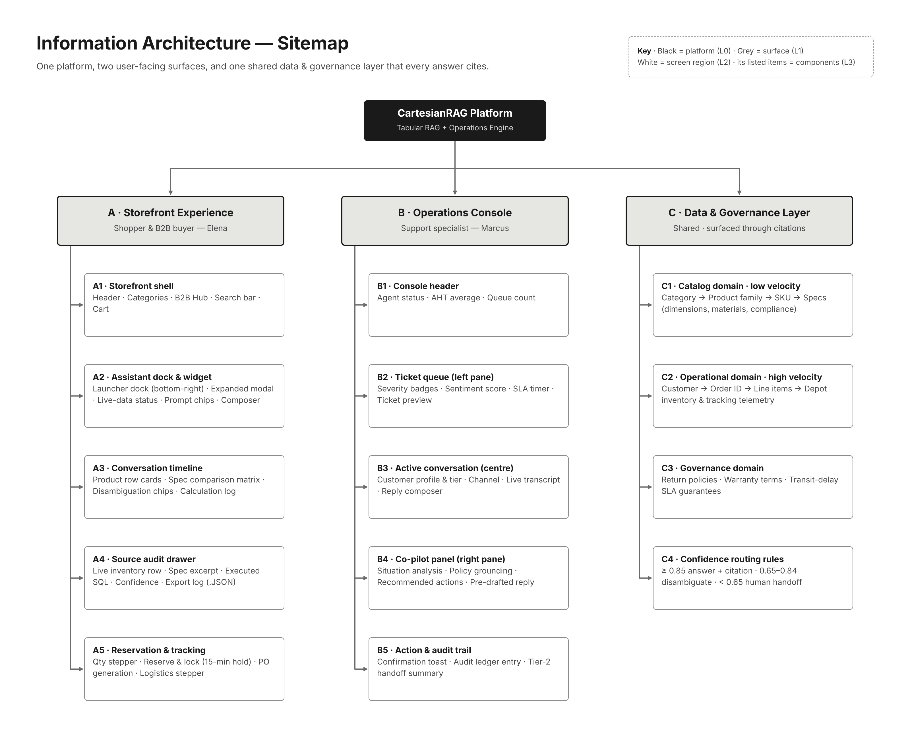

Think of CartesianRAG like a school building. The **platform** is the building, and it has two classrooms people actually walk into: the **Storefront** for Elena and the **Operations Console** for Marcus. Behind both sits the **library**, the data and governance layer, which every answer must cite.

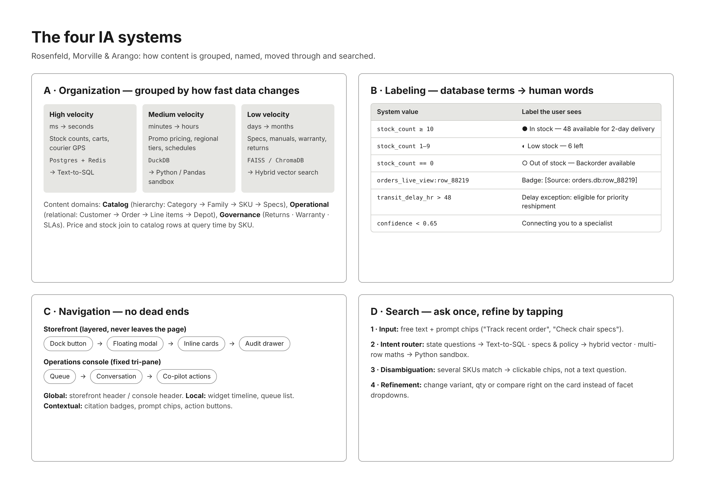

- **Organization:** catalog (slow), operations (fast), governance (policies).
- **Labeling:** database words become shopper words. `low_stock` becomes "Low stock · 6 left", and a citation becomes "✓ Verified · see source".
- **Navigation:** assistant dock → floating widget → inline cards → slide-over receipt drawer. The console uses three panes.
- **Search:** natural language in; "Did you mean…?" chips when a question matches several products.

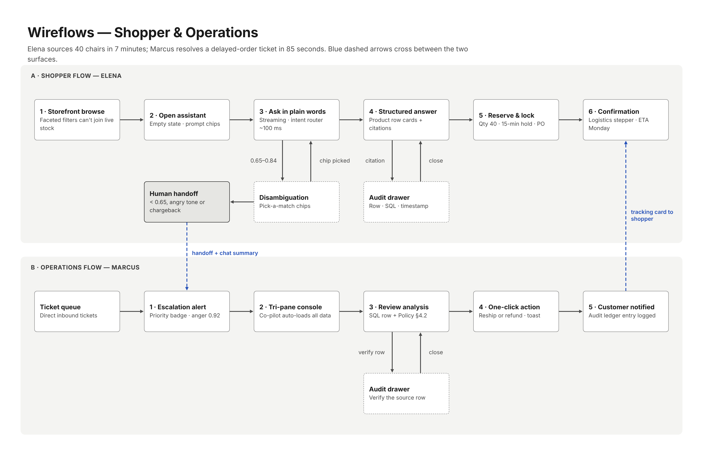

### Low-Fidelity Wireframes

| Screen | What it shows |
| :---: | :--- |
| S1 | Storefront with the assistant and product cards |
| S2 | Source audit drawer |
| S3 | Operations co-pilot console |
| S4 | Mobile assistant with spec comparison |

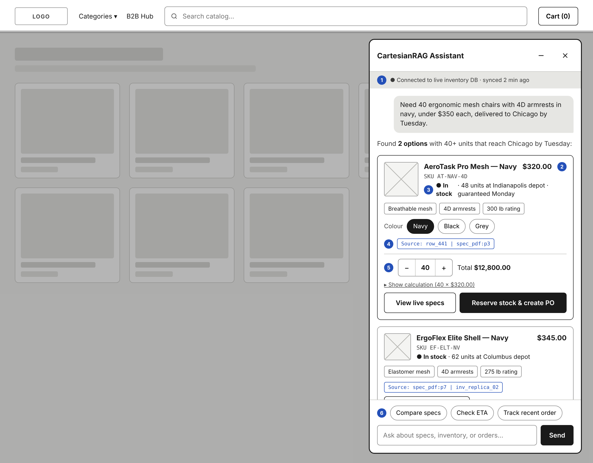
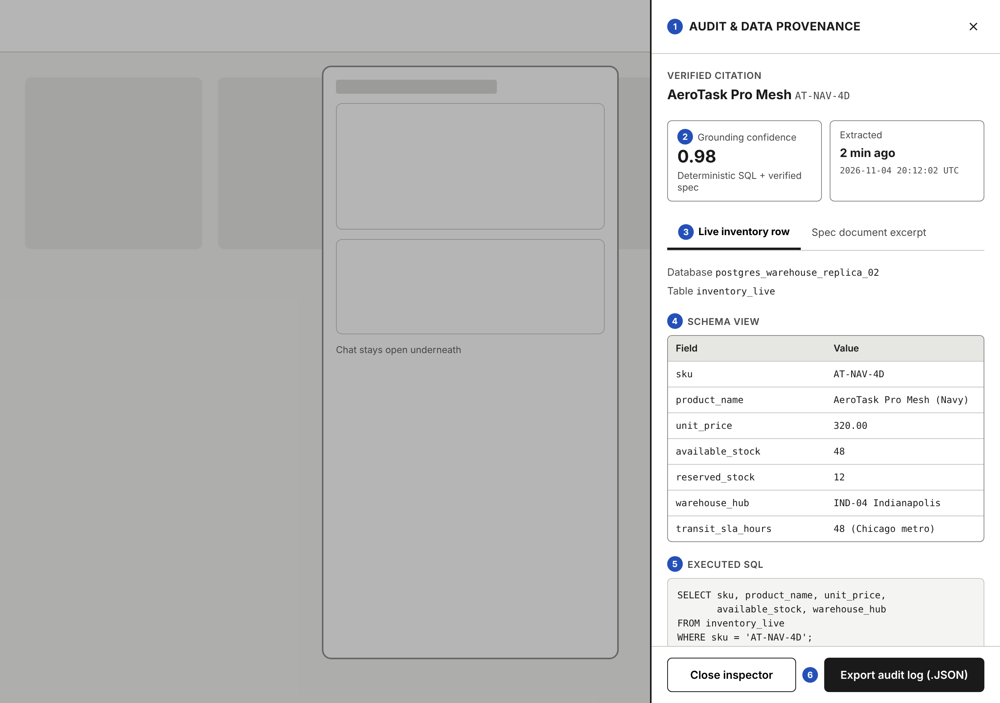
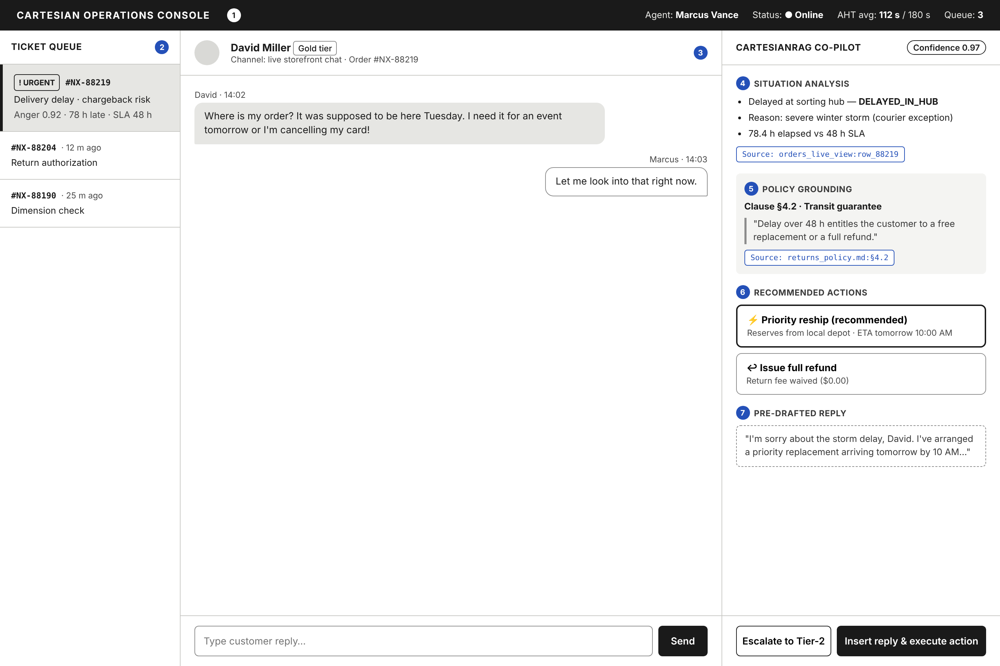
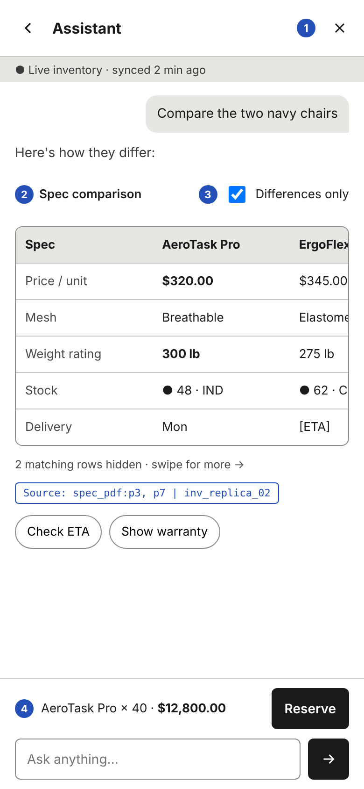

### Component States

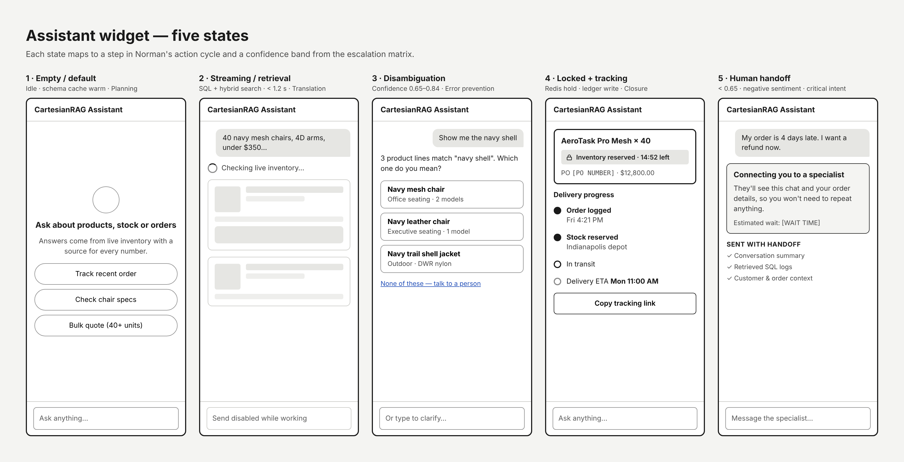

| State | Designed in v1–v3 | Changed by the engine (v4) |
| :--- | :--- | :--- |
| Empty | 3 suggested prompt chips | Unchanged |
| **Waiting** | Skeleton cards, "Checking live inventory…", budget under 1.2 s | **A screen of its own.** Real steps, an elapsed timer and the honest range (6–40 s). Recorded answers replay their real step timings at 4× speed, labelled (R3) |
| Answer | Product cards with stock and citation | Cards built from the contract, now with quantity and **Hold** (R1), and the requirements the engine used shown as **removable chips** above them (R4) |
| Disambiguation | "Did you mean…?" chips | Triggered by a measurable rule: top matches from **different categories** (E15, E34) |
| **Nothing matches** | Not designed | **New state:** one button per requirement that, if dropped, gives results ("Show 1 option without the delivery-time limit") (E22, R5) |
| **Lookup** | A plain text answer | **New state:** one big number and a sentence saying what it's about ("48 · navy AeroTask Pro Mesh available at Indianapolis Regional") (R6) |
| Hand-off | "Connecting you to a specialist" | Unchanged; triggered by a safety rule before any AI runs |

---

## Design ↔ Engine *(measured)*

This chapter is why the engine was built. Each story below follows the same shape:

```
  what I expected  ──►  what the engine showed  ──►  what changed in the design
```

### How the engine was measured

- **An answer key of 43 questions**, every answer proven against the database by a script (`check_answer_key.py`, 43/43). It contains 35 questions across all stations and 8 fresh router questions.
- **Three outcomes, not two:**
  - **RIGHT**
  - **hand-off:** safe; a person takes over
  - **WRONG:** dangerous; a confident, plausible, incorrect answer

  A system that hands off when unsure is far better than one that is wrong with confidence.
- **Fresh sets.** After tuning rules on some questions, new phrasings were written and scored *without* further tuning. This is the only fair test (E21).
- **Right for the right reason.** Questions can name an `expected_sku`, and the receipt must point to it (E25).
- **Regression runs.** The whole evaluation runs again after every change.

### Scoreboard

| Run | What was measured | Result |
| :--- | :--- | :--- |
| Run 1–2 | SQL station, 11 lookups, `qwen2.5-coder:3b` | **11/11** right; median 7.8 s |
| Run 5 | Search, 10 descriptive questions (hit in top 5) | Keyword 8/10 · Meaning **10/10** · Hybrid **10/10** |
| Run 6 | Multi-rule questions, AI writes the whole SQL | **0/6**, 6 wrong |
| Run 7 | Same questions, AI fills a *form* instead | **5/6**; with rules filling gaps **6/6** |
| Run 8–10 | 7 fresh phrasings, AI + rules | **7/7**; median 11.0 s after the "write less" fix |
| Run 11 | Whole pipeline, no AI | Router fresh **4/8**; answers 26/35, 4 wrong; 8 ms |
| **Run 12** | **Whole pipeline, AI where it helps** | **Router fresh 8/8; answers 33/35, 2 wrong; median 7.0 s** |
| Run 13 | API tests (`test_api.py`) | **15/15** pass |
| Run 14 | Demo recorded with AI (18 Nov) | 12/12 answers correct; 1 ms to 40.4 s |
| Run 15 | Review fixes R4–R6 in the engine; demo re-recorded with AI (19 Nov) | API tests **23/23**; 12/12 answers correct; questions 5.0–10.8 s; 25 one-tap removals at 1–4 ms each |

### Story 1: The wait is a screen, not a flicker

- **Expected:** a 1.2 s budget, covered by skeleton cards.
- **Showed:**
  - Lookups take about 8 s, and multi-rule questions 11–20 s (E1, E31).
  - Over 99.9% of that time is the AI model *writing*. The database part takes 1–40 ms.
  - A stopwatch showed the model **reads 518 tokens/s but writes only 8 tokens/s** (E30). Telling it to write only the boxes it fills cut writing time by 47%, with no loss of accuracy (E31).
  - Searches paid for an AI tie-breaker every time, and the first search also loaded the embedding model: up to 40 s (E45).
- **Design change (R3):** the waiting state now shows the real steps, an elapsed timer and an honest range. In the recorded demo, each answer replays its *real* step timings at 4× speed, says "The real engine took 18.4 s", and offers "Skip the wait". The step list also teaches something: nearly all the time sits on "Reading your request (small AI model)".

### Story 2: A confident "No" is the most expensive failure

- **Expected:** the main risk was a wrong *number*.
- **Showed:** the worst failure was a wrong *absence*. When the AI wrote whole SQL queries, it invented product names ("Mesh Chair") and exact-matched descriptive text. All six of Elena's questions came back "Nothing matches" (E18, E19).
- **Engine change:** a **grounding check**. When a query returns nothing, every exact value it searched for is checked against the real database. Invented values cause a retry, then a hand-off. Real-but-absent values ("pink") are still an honest "No".
- **Design change:** "nothing matches" must never end the conversation. The engine now finds the single requirement that, if relaxed, would give results, and the screen says so (E22). Making that hint a tappable button is review finding R5.

### Story 3: Make the AI's job smaller before making the AI bigger

- **Showed:**
  - Same model, same questions, different job. Writing whole SQL scored **0/6**. Filling in a form of allowed values scored **5/6** (E24).
  - Rules plus AI together scored 6/6 and 7/7. Each covered the other's blind spot. The AI reads "forty" and "how much for"; the rules never forget "don't mind which warehouses" (E26, E28).
- **Design change:** the form became the contract's `constraints` field. The screen can show it, which is review finding R4 ("show requirements as removable chips").

### Story 4: Overfitting, twice

- **Showed:**
  - Rules written while looking at 6 questions scored 6/6 on them, and 5/7 on new phrasings (E21).
  - The router scored 35/35 on its own questions and 4/8 on fresh ones. Every miss fell into the default "search" bucket, including **two upset customers who would have been shown a product list** (E32).
- **Engine change:** rules first, AI only for the leftovers. The AI picks one word out of four, and any other word is rejected. Fresh router score: **8/8** (E33, E36).
- **Design lesson:** a score on questions you designed for is not a score. The same applies to usability tests: tasks written around the prototype's happy path will flatter it.

### Story 5: Memory without a memory

- **Showed:**
  - "Same chairs, but within 2 days" works by carrying the previous answer's form forward and changing one box (E23).
  - The API remembers nothing. The browser sends the form back with the next question (E40).
  - A speed fix once silently broke this. The follow-up lost the quantity and budget, and a $365 chair got through (E38). The regression run caught it.
- **Design change (R4, done):** memory that is invisible can't be checked. Every shopping answer now shows the requirements it used as chips (`40 units ×` `Navy ×` `Under $350 each ×` `Within 2 days ×`). That bug would have been visible to anyone at a glance. Tapping × re-runs the same form minus that box (Story 9).

### Story 6: Right for the wrong reason

- **Showed:** Elena asked for *navy* chairs. The AI left the colour out, the engine picked black, and the total was still right because every colour costs $320. The marking said RIGHT. The receipt pointed at the wrong chair (E25).
- **Engine change:** with no colour given, the engine never silently picks one. If prices match, it says "any colour, same price" and cites every colour. If prices differ, it asks "Which colour?".
- **Design lesson:** the audit drawer is only as honest as the row the engine chose to cite.

### Story 7: Ambiguity needs a rule, not a feeling

- **Showed:** "Show me the navy shell" returned a side chair, a jacket and an office chair, with scores within 3% of each other (E15).
- **Engine change:** if a question's distinctive words match products from **different categories**, the engine asks instead of guessing (E34).
- **Design result:** "Did you mean…?" chips that name each product's category, colour and price. The expert review rated these one of the clearest parts of the interface.

### Story 8: The contract grew because of testing

- **Showed:**
  - `table` was added so answers could be marked without reading prose.
  - `trace` (the SQL and number of tries) was added because an empty answer left no clue about what went wrong (E4).
  - `constraints` already had a place in the design, and it turned into conversation memory.
- **Design lesson:** "can we debug it?" and "can we mark it?" are design requirements too.

### Story 9: A sentence is a dead end for a screen

- **Expected:** three review findings looked like screen work: make the "nothing matches" hint tappable (R5), say what a lookup number is about (R6), let shoppers remove a remembered requirement (R4).
- **Showed:** the screen couldn't do any of them, because the engine only sent **sentences**. "Without the delivery-time limit, 1 option would match" can be read, but not turned into a button. "available: 48" doesn't say 48 of what.
- **Engine change (E46):** the contract grew again, with **data** instead of words:
  - `relax`: each single requirement whose removal gives results (`field`, `label`, `matches`).
  - `drop`: the API takes one requirement to remove. The previous form minus that box goes straight to the hybrid station. No AI re-reads anything, so it answers in **1–4 ms** and can't mishear.
  - `subject`: what a lookup is about, read from the query's own exact filters and checked against the database. The AI never writes the sentence; the screen builds it from checked values.
- **Measured:** API tests 15 → **23**, all passing. The rules-only regression run was unchanged. The AI re-recording got all 12 answers right, and the recorded lookup came back with product, colour, warehouse and SKU.
- **Design lesson:** if a design needs the user to *act* on something, the engine has to send it as data. Words can only be read.

---

## Evaluating the Design

### Part 1: Simulated usability round *(simulated)*

> **Disclosure:** ten **synthetic** participants (5 shoppers, 5 support agents) were walked through Prototype v1 on paper, using the personas and known interaction patterns. **No real people took part.** v3 reported their times, SUS scores and quotes. v4 drops those numbers because they were predictions, not measurements. The *findings* are kept as hypotheses, because several were later confirmed by the expert review.

| # | Predicted problem | What happened since |
| :---: | :--- | :--- |
| F1 | Shoppers don't see the citation badge as clickable (it looked like code) | **Fixed:** "✓ Verified · see source". The expert review confirmed it now reads as proof |
| F2 | "Reserve stock & create PO" sounds like it charges money | **Fixed:** engine cards say "Hold 40 chairs for 15 min" with "No charge until your purchase order is approved" under the button, and the confirmation repeats it |
| F6 | The 15-minute countdown causes anxiety | **Fixed:** the held state says what happens at zero ("they go back on sale; you can hold them again if they're still there") |
| F3 | Agents can send a promise without the action behind it | Open (Marcus's console not yet connected) |
| F4 | Recommendations don't explain *why* | Open |
| F5 | Sideways scroll on the phone comparison table is invisible | Open |
| F7 | Changing colour silently changes the delivery date | Open |
| F8 | Compliance buyers want to download evidence | Open |

### Part 2: Expert review against Nielsen's heuristics *(expert review)*

**Method.**
- One reviewer checked **16 states** of the engine-connected prototype in a real browser, against Nielsen's 10 usability heuristics.
- Each problem was rated: **3** = fix before testing, **2** = fix soon, **1** = cosmetic.
- **Limit:** Nielsen recommends 3–5 reviewers, and this review had one (an AI assistant, Claude). It finds *likely* problems; it does not replace watching people.

**Result: 12 problems (3 major, 5 minor, 4 cosmetic). None was about wrong data.** All were about how answers are shown and what the shopper can do next.

| # | Problem | Severity | Status |
| :---: | :--- | :---: | :--- |
| R1 | Engine-built cards had no quantity or Reserve, so Task A couldn't be finished | 3 | **Fixed** |
| R2 | On a phone, the test bar covered the assistant's title and close button | 3 | **Fixed** |
| R3 | The waiting state didn't match the real 6–40 s wait | 3 | **Fixed** (screen); live step-by-step progress needs the engine to stream its steps |
| R4 | Follow-up requirements carried forward invisibly | 2 | **Fixed:** removable requirement chips; engine takes `drop` |
| R5 | "Without the delivery-time limit, 1 option would match" isn't tappable | 2 | **Fixed:** one button per way out; engine sends `relax` |
| R6 | "Available: 48" doesn't say 48 of what, where | 2 | **Fixed:** big number + sentence; engine sends `subject` |
| R7 | Colour chips look tappable but do nothing | 2 | **Fixed:** shown as plain text ("Also in Grey, Navy"), because the ticket carries no stock per colour |
| R8 | Engine words ("pass every rule", table names) on the shopper's screen | 2 | **Fixed:** "match everything you asked for"; receipts read "inventory · AT-NAV-4D"; model name moved to Engine details |
| R9–R12 | Duplicate hand-off text; engine panel on every answer; truncated chips; "live inventory" claim in recorded mode | 1 | **Fixed:** hand-off shown once; "Engine details" switch; full-length chips (one on phones); "Real answers, recorded 19 Nov 2026, replayed for this demo" |

**What the review said to keep:**
- receipts on every number;
- clear "Did you mean…?" chips;
- a "nothing matches" state that explains itself;
- instant hand-off for upset customers;
- honest replies to questions the demo can't answer;
- a status line that names the engine that produced the answers.

#### After the fixes

**R3: the wait, replayed honestly.** Nearly all of the 18.4 s is the AI reading the request. The database step takes milliseconds.

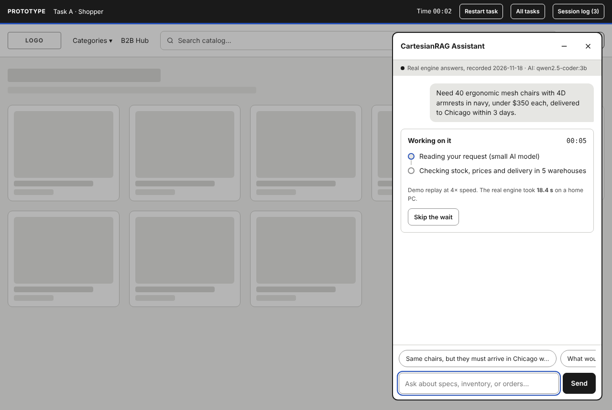

**R1: holding 40 chairs from an engine-built card.** The quantity starts at the 40 Elena asked for. Holding more than the depot has is blocked.

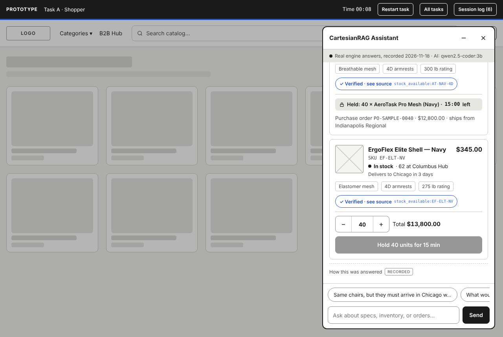

**R2: on a phone, before and after.** The assistant now starts below the test bar's measured height.

| Before | After |
| :---: | :---: |
| 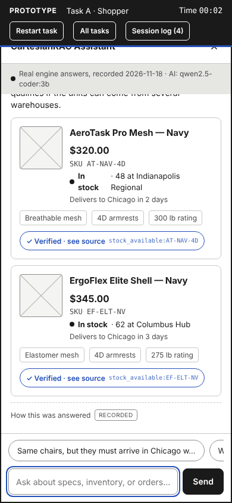 | 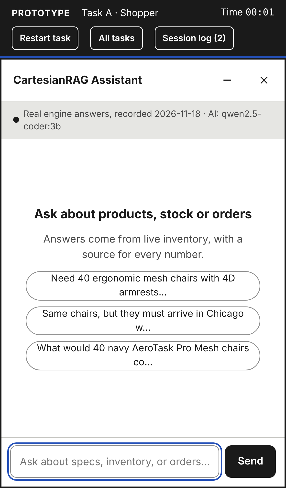 |

### Part 3: From wireframe to high fidelity

After the review, the prototype moved from greyscale to colour, built from a design system rather than styled screen by screen. The design system came first so the remaining fixes (R4–R12, mostly about consistency) would follow one set of rules instead of each inventing its own.

**The brief:** the store sells gear that works at a campsite and at a desk, so the look is the outdoors brought indoors.

| Role | Colour | Rule |
| :--- | :--- | :--- |
| Primary | Forest green | Main buttons, links, selected states |
| Secondary | Lantern yellow | Highlights and "way out" buttons. Always a fill with dark text, never text itself |
| Accent | Campfire red | Promo tags only ("New", "Camp-to-desk"). Never on buttons, errors or stock, because red reads as danger |
| Neutral | Browns | Every grey becomes wood, canvas or bark |

Two choices came from the engine and the review rather than the brand:

- **Status colours are a separate set.** "In stock" is lake blue, not the brand green, and every status is colour + dot shape + word. In stock and out of stock never depend on telling red from green.
- **Receipts have their own paper style:** a dashed "perforated" edge, a green tick and the row key in mono type. Proof always looks the same, and never like a button.

All 60 text and background pairs meet WCAG contrast in both themes (Daylight and Campfire night). The 16 components map one-to-one to what the engine returns: `product_card` → ProductCard, `no_results` + `relax` → NothingMatches, `constraints` → requirement chips, `subject` → AnswerFact, and so on.

**Elena's answer in high fidelity:** her requirements as removable chips, a "way out" for the one-warehouse assumption, and cards built from the contract.

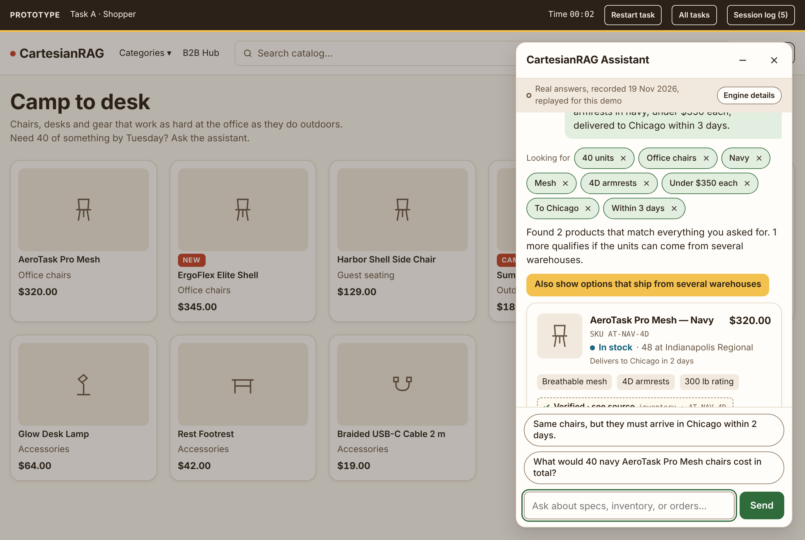

**Nothing matches, with ways out (R5):** one button per requirement that, if dropped, gives results. Each answers in milliseconds, with no AI.

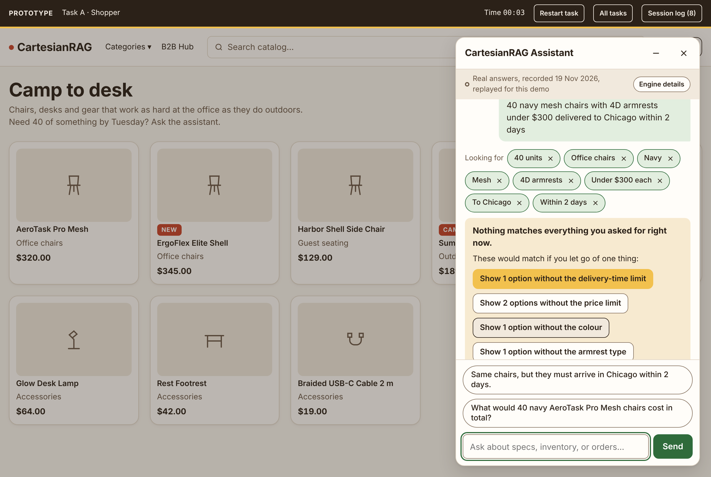

**A lookup that says what it's about (R6):**

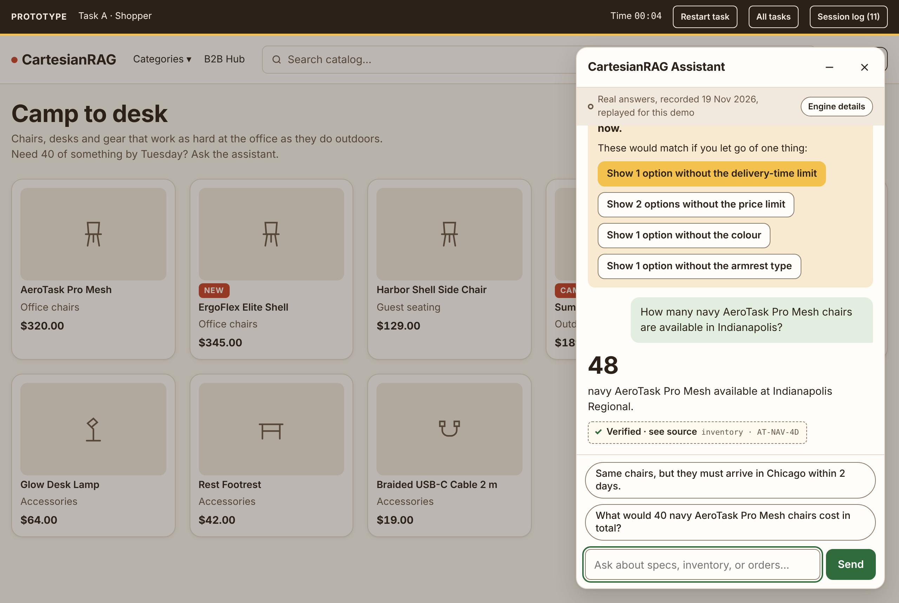

**The storefront on a phone:**

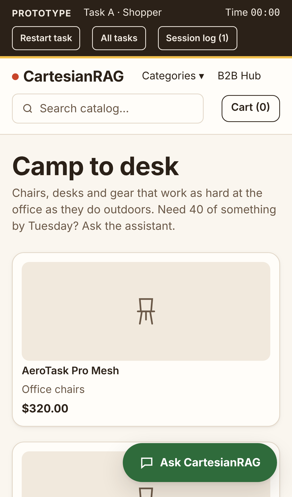

### Part 4: What has not been tested

- **No real participants.** Next: 2–3 informal sessions of Task A, including one on a phone, logged against the review findings.
- **Marcus's console** is not connected to the engine.
- **Live mode** has only been run on my own PC. Speed varied by up to 2× between days on the same hardware (E45).
- **Fresh "Did you mean…?" questions:** the ambiguity rule was written knowing its one test question.

---

## Technical Implementation *(as built)*

### Row-level search text

Each product becomes one searchable document. Stock and price are **not** in it: they are joined live from the tables by SKU, so a search hit never carries a stale stock number.

### Hybrid search: Reciprocal Rank Fusion

From `engine/app/search_station.py`. Two "detectives" rank the products: keyword (BM25) and meaning (embeddings). Each product scores 1 / (60 + its rank) from each detective, and the scores are added.

```python
RRF_K = 60     # the standard constant for Reciprocal Rank Fusion

for ranking in (keyword_ranking, meaning_ranking):
    for position, doc_index in enumerate(ranking, start=1):
        fused[doc_index] = fused.get(doc_index, 0.0) + 1.0 / (RRF_K + position)
```

*Why it works:* a product that both detectives rank highly wins. A product only one detective likes can still make the top five. That is how "stackable chairs" (keyword wins) and "something to charge my laptop" (meaning wins) are both found (E11).

### AI fills the form, rules fill the gaps

From `engine/app/extractors/combined.py`:

```python
def make_combined(ai_extract, rules_extract):
    def extract(question, previous=None):
        ai_form = ai_extract(question, previous) or {}
        rules_form = rules_extract(question, previous) or {}
        merged = dict(ai_form)
        for field, value in rules_form.items():
            if field == "follow_up" or value is None:
                continue
            if merged.get(field) in (None, "", []):   # AI left it empty
                merged[field] = value                  # -> use the rules' value
        return merged
    return extract
```

The merged form is grounded against the real vocabulary, then turned into **parameterised** SQL by tested code. The AI never writes SQL for these questions, and text typed by a shopper can never run as a command.

### The contract

Every answer is a ticket that must validate against `answer.schema.json`:
- `state`: answer, no_results, disambiguate or handoff
- `message`
- `components`: product cards, choices, hand-off
- `table`: the raw rows
- `citations`
- `constraints`: the form, which also serves as memory
- `calculation`
- `trace`: station, SQL, tries, router reason
- `timing_ms`

The prototype draws the screen from the ticket alone.

### Delivery

- A **FastAPI** endpoint (`POST /ask`) returns tickets.
- GitHub Pages can't run Python, so the published prototype **replays real tickets** recorded from the engine (`prototype/answers.json`, AI preset, 18 Nov 2026). The status line says so.
- Opening the prototype with `?api=http://localhost:8000` switches it to the live engine.

---

## Evaluation Results *(measured)*

This replaces the v3 benchmark table, whose numbers were not measured.

| Measure | Rules only | With AI (`qwen2.5-coder:3b`) |
| :--- | :---: | :---: |
| Answers right (35-question key) | 26 | **33** |
| Hand-offs (safe) | 5 | 0 |
| Wrong (dangerous) | 4 | **2** |
| Router, 8 fresh questions | 4/8 | **8/8** |
| Contract-valid tickets | 35/35 | 35/35 |
| Median time per answer | **8–10 ms** (two runs) | 7.0 s |

| Station (with AI) | Right | Median time |
| :--- | :---: | :---: |
| Search | 10/10 | 6.2 s |
| SQL lookups | 10/11 | 7.9 s |
| Hybrid (multi-rule) | 12/13 | 10.9 s |
| Hand-off | 1/1 | 0 ms |

*Hardware:* a home Windows PC with no graphics card, running models through Ollama. *Caveats:*
- 35 questions is a small set.
- One run is evidence, not proof: the same model gave a different answer to one question on a different day (E37).
- The trade-off is plain. AI fixes the rules' blind spots, and costs about 7 seconds per answer on this hardware.

---

## Repository Structure

```
CartesianRAG/
├── cartesian-rag-enterprise-case-study-v4.md   ← this document
├── images/                    wireframes, review and high-fidelity screenshots
├── design-system/             tokens.json, brand book (README), 16 components + bundle.css
├── prototype/
│   ├── index.html             clickable prototype (scripted, recorded or live)
│   └── answers.json           real engine tickets, replayed on GitHub Pages
├── research/                  usability test kit and results tracker
└── engine/
    ├── README.md              how to run everything
    ├── FINDINGS.md            every measured result, E1–E45
    ├── requirements.txt
    ├── contract/              answer.schema.json + example tickets
    ├── data/                  build_store.py → store.db (+ CSVs)
    ├── app/                   router, stations, guard, grounding, API
    └── eval/                  questions.json (answer key) + scoring scripts
```

### Run it

```bash
cd engine
python -m pip install -r requirements.txt
cd data && python build_store.py                     # same store every time
cd ../eval && python run_pipeline_eval.py no-ai      # whole engine, no AI, ~1 s

# With AI (needs Ollama):
ollama pull qwen2.5-coder:3b
ollama pull nomic-embed-text
python run_pipeline_eval.py ai

# The API + live prototype:
cd ../app && python -m uvicorn api:app --port 8000
# open prototype/index.html?api=http://localhost:8000
```

---

## What's Next

1. **Grow the catalog to match the brand:** the store's data has office chairs, desks and one jacket, but no mugs, cups or camping tables. Adding them changes the answer key, so it needs a new evaluation run.
2. **Make the engine faster where the design feels it:**
   - warm up the embedding model;
   - skip the AI tie-breaker for questions with no complaint words;
   - stream steps from the API so live mode can tick them off.
3. **Test with people:** 2–3 informal Task A sessions, including on a phone, logged next to the review findings.
4. **Connect Marcus's console** to the engine and re-check F3 and F4.
